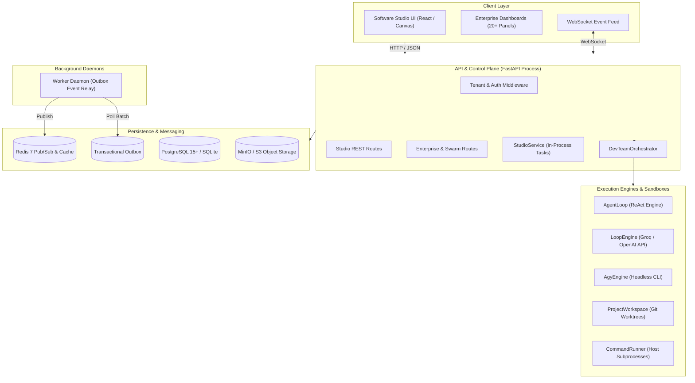

# Autonomous Agency — Current System Architecture
**Date:** November 2026  
**Document Version:** 2.0  
**Scope:** Technical Architecture, Subsystems, and Component Interactions  

---

## 1. System Topology & Architecture Overview

The Autonomous Agency is currently implemented as an asynchronous Python (FastAPI) platform paired with a TypeScript/React frontend, PostgreSQL/SQLite storage, Redis event messaging, and MinIO object storage.

The codebase embodies a **dual-architecture profile**:
1. **The Software Studio Multi-Agent System**: An operational engineering harness where a dedicated agent roster (Manager, Developers, QA, Reviewer) collaborates on local Git repositories using isolated Git worktrees and real-time isometric pixel-art office telemetry.
2. **The Enterprise / Company OS System**: A deep 22-phase organizational simulation consisting of departments, employee lifecycles, dynamic agent swarms, 10-stage operating cycles, strategic intelligence, and governance verification.



---

## 2. Control Plane vs. Execution Plane Dynamics

### 2.1 The Current Tight Coupling
In the existing codebase, the **Control Plane** (HTTP request handling, authentication, project creation, route validation) and the **Execution Plane** (running LLM prompts, file editing, running tests, Git branch management) are **tightly coupled within the same FastAPI server process**:

* When a project starts (`POST /api/studio/projects/{id}/start`), `StudioService.start()` calls:
  ```python
  task = asyncio.create_task(
      orchestrator.run_project(project_id, should_cancel=...),
      name=f"studio-{project_id}",
  )
  self._tasks[project_id] = task
  ```
* **Implication**: Long-running engineering workflows run as in-memory coroutines inside the web process. If uvicorn/gunicorn restarts, reloads during development, or crashes under memory pressure, all active agent runs terminate mid-execution.
* **The Worker Daemon**: Although `src/infrastructure/worker.py` and `Dockerfile.worker` exist, they currently operate solely as a `TransactionalOutboxProcessor` polling the `outbox` table and publishing events to Redis. They do **not** claim or execute agent tasks.

---

## 3. Core Execution Subsystems

### 3.1 Software Studio Orchestrator (`DevTeamOrchestrator`)
Located in [`src/application/dev_team_service.py`](file:///d:/agency/src/application/dev_team_service.py):
* **Manager Agent (`TeamRole.MANAGER`)**: Breaks user goals into atomic tickets using `MANAGER_PROMPT` and `SUBMIT_PLAN_TOOL`. Validates acyclic ticket dependencies (`depends_on`).
* **Developer Agents (`TeamRole.DEVELOPER`)**: Claim tickets from the `TODO` column, checkout dedicated Git worktrees, execute the ReAct loop to edit code, and verify their own changes.
* **QA Agent (`TeamRole.QA`)**: Executes real test commands (e.g., `pytest`, `npm test`) via `CommandRunner`. Completely deterministic (no model hallucination of test results).
* **Code Reviewer (`TeamRole.REVIEWER`)**: Inspects `git diff` against base branch, verifying code against acceptance criteria via `SUBMIT_REVIEW_TOOL`.
* **Merge Lock**: An `asyncio.Lock()` serializes merges into the project branch once QA and Reviewer approve, preventing branch race conditions.

### 3.2 Pluggable Dual Execution Engines
Located in [`src/application/agent_engine.py`](file:///d:/agency/src/application/agent_engine.py):
* **`LoopEngine`** ([`src/infrastructure/coding/loop_engine.py`](file:///d:/agency/src/infrastructure/coding/loop_engine.py)): Uses [`AgentLoop`](file:///d:/agency/src/application/agent_loop.py) to manage a multi-turn ReAct cycle with direct model APIs (Groq, OpenAI, Anthropic) driving [`CodingToolbox`](file:///d:/agency/src/infrastructure/coding/toolbox.py). Includes JSON salvaging (`_salvage_final_answer`) for malformed function calls.
* **`AgyEngine`** ([`src/infrastructure/coding/agy_engine.py`](file:///d:/agency/src/infrastructure/coding/agy_engine.py)): Subprocess-driven execution adapter invoking the headless Antigravity CLI (`agy`) over stdio, streaming diffs and tool executions with zero API key requirement.

### 3.3 Git Worktree Concurrency
Located in [`src/infrastructure/coding/workspace.py`](file:///d:/agency/src/infrastructure/coding/workspace.py):
* Parallel developers work in physical subdirectories:
  ```
  .agency/workspaces/<project_id>.worktrees/<ticket_id>/
  ```
* Each worktree is checked out on an isolated branch: `agency-ticket/<project_id>/<ticket_id>`.
* Guarantees zero file-write collisions between concurrent developers and allows clean per-ticket discards if an attempt violates boundaries.

### 3.4 Command Execution & Process Lifecycle
Located in [`src/infrastructure/coding/command_runner.py`](file:///d:/agency/src/infrastructure/coding/command_runner.py):
* Validates command tokens against an allowlist (`STUDIO_ALLOWED_COMMANDS`).
* Rejects shell operators (`&&`, `||`, `|`, `;`, `>`, `<`).
* Cleanses sensitive environment variables containing `KEY`, `TOKEN`, `SECRET`, `PASSWORD`.
* Cross-platform process termination (`_kill_tree`) using `taskkill /F /T /PID` on Windows and `os.killpg(SIGKILL)` on POSIX to prevent orphaned child processes.

---

## 4. Enterprise / Company OS Subsystems

Located across [`src/domain/`](file:///d:/agency/src/domain/) and [`src/application/`](file:///d:/agency/src/application/):
* **Employee & Agent Lifecycle** ([`src/domain/agent.py`](file:///d:/agency/src/domain/agent.py), [`src/domain/employee.py`](file:///d:/agency/src/domain/employee.py)): Rich organizational models with skill matrices, capability maps, and finite state machines (`AgentState`, `EmployeeStatus`).
* **Swarm Coordination Engine** ([`src/application/swarm_service.py`](file:///d:/agency/src/application/swarm_service.py)): Dynamic agent cluster provisioning with inter-agent messaging, budget caps, and swarm conflict resolution.
* **Operating Cycle & Strategic Intelligence** ([`src/application/company_operating_cycle_service.py`](file:///d:/agency/src/application/company_operating_cycle_service.py)): 10-stage organizational heartbeat (Observation, Evaluation, OKR Alignment, Workforce Allocation, Execution, Post-Mortem).
* **Research & Discovery** ([`src/application/research_services.py`](file:///d:/agency/src/application/research_services.py)): Formal hypothesis management, research questions, citation indexing, and benchmark generation.
* **Verification & Dual-Control Engine** ([`src/application/verification_engine.py`](file:///d:/agency/src/application/verification_engine.py)): Dual-key authorization checks for high-impact actions.

---

## 5. Persistence, Migrations, and Multi-Tenancy

### 5.1 Database Schema (40 Alembic Migrations)
Located in [`migrations/versions/`](file:///d:/agency/migrations/versions/):
* `001` - `004`: Core agents, runs, steps, and checkpoints.
* `005` - `017`: Departments, employees, task engines, meetings, decisions, and workforce models.
* `018` - `029`: Autonomous company cycles, research, swarms, business operations, and ventures.
* `030` - `040`: Multi-tenancy, identity/auth, budget governance, workflows v2, audit v2, and studio tables.

### 5.2 Multi-Tenant Context Propagation
Located in [`src/api/middleware/tenant.py`](file:///d:/agency/src/api/middleware/tenant.py) and [`src/infrastructure/tenant_context.py`](file:///d:/agency/src/infrastructure/tenant_context.py):
* Uses Python `ContextVar` to store `tenant_id` and `tenant_slug` extracted from bearer JWTs or API keys.
* SQLAlchemy models inherit from tenant-aware base mixins.
* Limitation: Background tasks spawned without context inheritance lose the tenant scope.

---

## 6. Frontend Presentation Layer

Located in [`frontend/src/`](file:///d:/agency/frontend/src/):
* **Root Router** ([`Root.tsx`](file:///d:/agency/frontend/src/Root.tsx)):
  * Default route renders `StudioApp` (Software Studio).
  * `#/legacy` route lazily renders `App.tsx` (20+ corporate dashboards: Platform Control Center, Company Intelligence, GTM, Venture Creation, Resilience).
* **Isometric Pixel Office** ([`frontend/src/studio/office/scene.ts`](file:///d:/agency/frontend/src/studio/office/scene.ts), [`OfficeView.tsx`](file:///d:/agency/frontend/src/studio/office/OfficeView.tsx)):
  * Custom 2D isometric canvas engine rendering animated pixel avatars for each team member.
  * Real-time spatial pathfinding and state synchronization: agents move to desks when working, to testing benches during QA, to conference whiteboards during planning, and to ping-pong/chess tables when idle.
* **WebSocket Live Feed** ([`frontend/src/services/websocketClient.ts`](file:///d:/agency/frontend/src/services/websocketClient.ts)): Streams activity events (`tool_call`, `ticket_moved`, `git_diff`, `qa_verdict`) directly to the canvas and event panels.

---

## 7. Architectural Bottlenecks & Evolution Path

1. **Decouple Control Plane from Execution Plane**: Split FastAPI web serving from task execution by placing durable job leases in PostgreSQL/Redis and migrating execution to standalone worker daemons.
2. **Move from Host Subprocesses to Container Sandboxes**: Upgrade `CommandRunner` from software allowlists to isolated Docker/gVisor micro-containers.
3. **Upgrade Manager to CEO DAG Planner**: Transition the linear ticket decomposition into a full-scale directed acyclic graph (DAG) capable of cross-department delegation and verification.
4. **Build Hybrid Execution Fabric**: Add secure outbound connection adapters for connected local Windows/Linux machines and remote cloud clusters.

