# Autonomous Agency — Strategic Repair & Phased Roadmap
**Date:** November 2026  
**Document Version:** 1.0  
**Target Architecture:** Autonomous AI Operating System  
**Implementation Methodology:** Incremental, Test-Driven, Zero-Breakage  

---

## 1. Roadmap Architecture & Execution Philosophy

This roadmap translates the **Master Project Directive** and the findings from [`docs/REPOSITORY_AUDIT.md`](file:///d:/agency/docs/REPOSITORY_AUDIT.md) into an actionable, phased engineering program.

### Core Principles
1. **Never sacrifice reliability for the appearance of autonomy**: Simulated features must be made real or clearly labeled.
2. **Fix correctness and security before adding features**: Sandboxing, tenant isolation, and approval binding precede complex orchestration.
3. **Control Plane / Execution Plane Separation**: The API process handles requests; dedicated worker daemons own execution leases.
4. **Preserve and Extend**: Reuse the 40 existing database migrations, domain state machines, and the Software Studio rather than rewriting from scratch.

---

## 2. Phased Roadmap Overview

```mermaid
flowchart LR
    P0["Phase 0: Stabilization & Security"] --> P1["Phase 1: Persistent Execution"]
    P1 --> P2["Phase 2: CEO Outcome DAG"]
    P2 --> P3["Phase 3: Universal Tools"]
    P3 --> P4["Phase 4: Hybrid Fabric"]
    P4 --> P5["Phase 5: Mobile Control"]
    P5 --> P6["Phase 6: Memory & Proactivity"]
    P6 --> P7["Phase 7: Org Intelligence"]
    P7 --> P8["Phase 8: Production Hardening"]
```

---

## 3. Phase Specifications & Deliverables

### Phase 0: Repository Stabilization & Immediate Security Repairs (Current Focus)
* **Objective**: Fix identified vulnerabilities, remove race conditions, and stabilize existing test and database baselines.
* **Key Tasks**:
  1. **SEC-02: Cryptographic Tool Approval Binding**:
     * Add `parameter_hash`, `workspace_root`, `tenant_id`, `expires_at`, and `consumed_at` to `ToolApproval` in [`src/domain/tool.py`](file:///d:/agency/src/domain/tool.py).
     * Enforce parameter verification and atomic consumption in [`src/application/tool_approval_service.py`](file:///d:/agency/src/application/tool_approval_service.py).
  2. **SEC-03: Atomic Audit Hash-Chain Integrity**:
     * Remove in-memory `_audit_chains` cache from [`src/application/audit_governance_v2.py`](file:///d:/agency/src/application/audit_governance_v2.py).
     * Implement database row-level sequence locking for audit appends to guarantee zero forks under concurrent writes.
  3. **SEC-04: Mandatory Tenant Context Propagation**:
     * Enforce non-nullable `tenant_id` across project creation, background workers, and CLI runners.
  4. **Finding 5: Durable Disaster Recovery Snapshots**:
     * Replace RAM dictionary in [`src/application/disaster_recovery_engine.py`](file:///d:/agency/src/application/disaster_recovery_engine.py) with database persistence.
     * Implement physical database backup generation and S3 upload.
  5. **SEC-05: Infrastructure Port Security**:
     * Bind development ports to `127.0.0.1` in [`docker-compose.yml`](file:///d:/agency/docker-compose.yml).
     * Remove hardcoded passwords and mandate `.env` credentials.
  6. **Reconcile Documentation**:
     * Update `progress.md` and `README.md` to reflect 852 tests and 40 migrations.
* **Exit Condition**: All 852 tests pass, approval parameter tampering is blocked, concurrent audit writes maintain 100% integrity, and infrastructure ports are secured.

---

### Phase 1: Persistent Execution Foundation
* **Objective**: Decouple the FastAPI API server from agent task execution; establish a durable job queue that survives server restarts.
* **Key Tasks**:
  1. **Standardized Runtime Contract (`AgentRuntime`)**:
     * Define the core protocol: `execute(task, context)`, `cancel(id)`, `get_status(id)`, `health_check()`, `recover(id)`.
     * Adapt `LoopEngine` and `AgyEngine` to implement this contract.
  2. **Durable Job Queue & Worker Leases**:
     * Implement a PostgreSQL-backed job queue model (`task_executions`) with atomic leasing (`worker_id`, `lease_expires_at`, `heartbeat_at`).
     * Workers periodically refresh their lease; expired leases trigger automated failover to other workers.
  3. **Transform Worker Daemon**:
     * Upgrade [`src/infrastructure/worker.py`](file:///d:/agency/src/infrastructure/worker.py) from a simple outbox relay to an active agent worker capable of claiming and executing long-running studio projects and tasks.
  4. **Checkpoint Restoration & Idempotency**:
     * Persist intermediate step artifacts and git commit SHAs; workers recovering a failed task resume from the last valid checkpoint without repeating non-idempotent actions.
* **Exit Condition**: Killing or restarting the FastAPI process during a live project run does not abort execution; another worker daemon seamlessly takes over and completes the task.

---

### Phase 2: CEO Planning Engine & Organizational DAG Orchestration
* **Objective**: Enable the system to receive high-level outcomes and orchestrate multi-department workflows.
* **Key Tasks**:
  1. **CEO Outcome Intake & Decomposition**:
     * Implement the CEO Executive Agent capable of parsing complex outcome goals ("Investigate framework X, develop working prototype, run tests, open PR").
     * Decompose the outcome into a Directed Acyclic Graph (DAG) of subtasks with typed inputs, outputs, and acceptance criteria.
  2. **Cross-Department Delegation**:
     * Route tasks across specialized departments (Research, Engineering, QA, Documentation, Security).
     * Implement structured inter-employee deliverable handoffs.
  3. **Dynamic Replanning & Blocker Resolution**:
     * If a subtask or dependency fails, the CEO agent dynamically re-evaluates the DAG, reallocates employees, or requests human intervention.
* **Exit Condition**: An objective spanning research and software engineering is autonomously decomposed, distributed across multiple specialized employees, verified, and delivered.

---

### Phase 3: Universal Tool Ecosystem & Secure Sandboxing
* **Objective**: Build a unified, capability-driven tool registry with OS-level sandboxing.
* **Key Tasks**:
  1. **Universal Tool Registry**:
     * Standardize tool contracts across 7 categories: Development, Browser, Research, Data Analysis, Business Operations, Productivity, Infrastructure.
  2. **Containerized Execution Sandbox**:
     * Replace unconfined host execution in `CommandRunner` with ephemeral Docker/gVisor container workers.
     * Enforce strict cgroups (CPU/RAM quotas), read-only root filesystems, and network egress controls.
  3. **Model Provider Registry & Intelligent Routing**:
     * Centralized provider catalog (Groq, OpenAI, Anthropic, Ollama, Antigravity CLI).
     * Route tasks based on cost, latency, capability requirements, and provider health.
* **Exit Condition**: Agents execute real multi-domain workflows inside isolated container sandboxes with enforced resource and network quotas.

---

### Phase 4: Hybrid Execution Fabric
* **Objective**: Connect the agency server to remote local computers (Windows/Linux) and isolated cloud clusters.
* **Key Tasks**:
  1. **Connected Local Agent (`agency-agent`)**:
     * Build a lightweight daemon that users install on their local machines.
     * Establishes an authenticated, encrypted outbound connection (WebSocket / mTLS) to the Agency server (no open inbound ports on the user's router).
  2. **Device Registration & Fine-Grained Permissions**:
     * User explicitly configures which directories, local tools, and hardware resources are exposed.
     * Capability discovery and instant device revocation controls.
  3. **Environment Router**:
     * Intelligently routes tasks to Agency Cloud, Local PC, or Container Workers based on data location, hardware requirements (e.g. local GPUs), and privacy policies.
* **Exit Condition**: A task requiring a local repository on the owner's PC is routed to the connected local agent, executed securely, and reported back to the central agency.

---

### Phase 5: Mobile Mission Control & Interactive Takeover
* **Objective**: Provide a first-class mobile operating surface with push alerts and real-time takeover.
* **Key Tasks**:
  1. **Mobile Command Center**:
     * Responsive mobile layout with voice-to-task intake, real-time progress feeds, and deliverable previews.
  2. **Mobile Approval Inbox**:
     * One-tap approval/rejection with full parameter diffs and risk classifications.
  3. **Live Browser & Workspace Takeover**:
     * Remote screenshot-based or streaming view of active browser/workspace sessions.
     * Ability to pause the agent, interact manually, and return control seamlessly.
  4. **Push Notifications & Offline Resilience**:
     * Push alerts for completed deliverables, approval requests, and blockers.
     * Automatic state resynchronization when mobile reconnects after offline periods.
* **Exit Condition**: The owner can assign a task, close the phone app, receive an approval notification while away, approve it, and inspect the verified result upon return.

---

### Phase 6: Multi-Tier Memory & Proactive Responsibility Engine
* **Objective**: Transition from strictly reactive prompts to continuous, proactive organizational responsibilities.
* **Key Tasks**:
  1. **Hierarchical Scoped Memory**:
     * Five distinct memory tiers: Owner, Organization, Project, Employee, Execution.
     * Scoped semantic retrieval with access boundaries and provenance tracking.
  2. **Ongoing Responsibilities**:
     * Assign continuous responsibilities (e.g., "Monitor repo CI, detect flaky tests, track security advisories").
     * Scheduled triggers and event-driven opportunity discovery within approved budgets.
* **Exit Condition**: The agency proactively identifies a broken test or security vulnerability, prepares a patch in an isolated worktree, and notifies the owner with a reviewable PR.

---

### Phase 7: Advanced Organizational Intelligence
* **Objective**: Optimize operations using historical performance and organizational simulation.
* **Key Tasks**:
  1. **Digital Twin of the Organization**: Real-time representation of bottlenecks, skill gaps, and active workloads.
  2. **Mission Replay**: Interactive timeline reconstructor for auditing every decision, tool call, and approval.
  3. **Reusable Business Playbooks**: Convert successful workflows into versioned, executable playbooks.
  4. **Agency Simulation**: Dry-run complex multi-agent plans before real-world execution.

---

### Phase 8: Production Hardening & Disaster Recovery Drills
* **Objective**: Validate enterprise resilience, zero-trust security, and operational readiness.
* **Key Tasks**:
  1. Production Docker/Kubernetes deployment configurations.
  2. Automated disaster recovery drills verifying RPO < 5 min and RTO < 15 min SLAs against corrupted databases.
  3. Load testing and high-concurrency stress testing across distributed workers.

---

## 4. Immediate Next Steps (Starting Phase 0 Repairs)

1. **Implement SEC-02**: Add cryptographic parameter hashing and atomic single-use tokens to `ToolApproval` in [`src/domain/tool.py`](file:///d:/agency/src/domain/tool.py) and [`src/application/tool_approval_service.py`](file:///d:/agency/src/application/tool_approval_service.py).
2. **Implement SEC-03**: Fix audit hash-chain concurrency by introducing database sequence locking in [`src/application/audit_governance_v2.py`](file:///d:/agency/src/application/audit_governance_v2.py).
3. **Implement Finding 5**: Implement durable database snapshots in [`src/application/disaster_recovery_engine.py`](file:///d:/agency/src/application/disaster_recovery_engine.py).
4. **Implement SEC-05**: Update [`docker-compose.yml`](file:///d:/agency/docker-compose.yml) to bind ports to `127.0.0.1` and enforce required `.env` variables.
5. **Update Documentation**: Synchronize `progress.md` and `README.md` with verified metrics (852 tests, 40 migrations).

