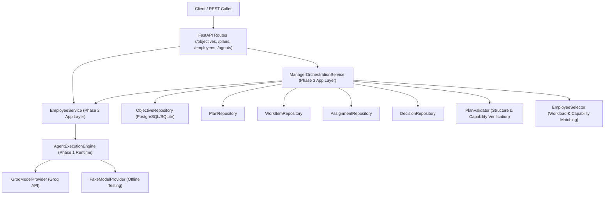
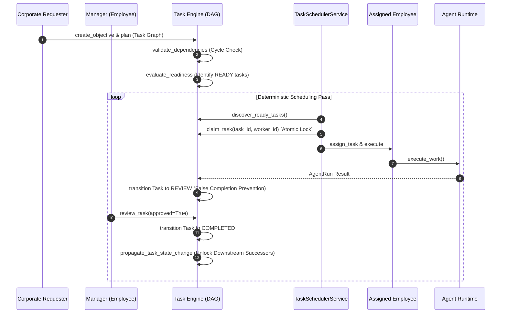

# Autonomous AI Organization Platform Architecture

## Core Architectural Principle

$$\text{COMPANY OS} \rightarrow \text{Authoritative State} \rightarrow \text{Event Projection} \rightarrow \text{Pixel Office} \rightarrow \text{Visualization}$$

$$\text{EMPLOYEE} \neq \text{AGENT} \neq \text{LLM} \neq \text{PIXEL OFFICE}$$

1. **Employee**: Represents organizational identity, corporate role, department membership, skills, capabilities, responsibilities, manager delegation hierarchy, and lifecycle state (`INACTIVE`, `ACTIVE`, `ON_LEAVE`, `SUSPENDED`, `TERMINATED`).
2. **Agent**: Represents execution capabilities, permission profile, model configuration, and state machine (`IDLE` → `READY` → `RUNNING`). An Employee delegates work to an Agent.
3. **LLM**: A model provider capability (e.g. Groq `llama-3.3-70b-versatile`) invoked by the Agent Runtime engine. The authoritative state and organizational truth belong strictly to the Agent Runtime and Company OS.
4. **Pixel Office**: Visual presentation & real-time event projection layer that visualizes backend reality without inventing or manufacturing organizational truth. See [docs/architecture/pixel-office.md](file:///d:/agency/docs/architecture/pixel-office.md) for full specification.

---

## Phase 3 Organizational Orchestration Architectural Boundary



---

---

## Phase 4 Chain of Command Flow

$$\text{Objective} \rightarrow \text{Plan} \rightarrow \text{Task Graph} \rightarrow \text{Readiness Evaluator} \rightarrow \text{READY Tasks} \rightarrow \text{Scheduler} \rightarrow \text{Assignment} \rightarrow \text{Employee} \rightarrow \text{AgentRun} \rightarrow \text{Review}$$



---

## Phase 3 Component Specifications

### 1. Domain Entities & State Machines
- **Objective**: Corporate goal entity (`RECEIVED` → `CLARIFICATION_REQUIRED` → `CLARIFYING` → `READY_FOR_PLANNING` → `PLANNING` → `PLANNED` → `EXECUTING` → `REVIEWING` → `COMPLETED` / `FAILED` / `CANCELLED`).
- **Plan**: Decomposed execution strategy (`DRAFT` → `PROPOSED` → `VALIDATED` → `APPROVED` → `REJECTED` → `EXECUTING` → `REPLANNING` → `COMPLETED`).
- **WorkItem**: Atomically scoped task unit (`PLANNED` → `ASSIGNED` → `IN_PROGRESS` → `REVIEWING` → `COMPLETED` / `BLOCKED` / `CANCELLED`).
- **Assignment**: Allocation record connecting WorkItem to an active Employee (`ACTIVE`, `INACTIVE`, `REASSIGNED`, `COMPLETED`, `CANCELLED`).
- **ManagerDecision**: Audited record of managerial choices (`APPROVE_PLAN`, `REJECT_PLAN`, `ASSIGN_WORK`, `REASSIGN_WORK`, `CLARIFY_OBJECTIVE`, `RESOLVE_BLOCKER`, `ESCALATE`, `APPROVE_RESULT`).

### 2. Manager Role Capabilities & Hierarchy Cycle Detection
- **Manager Authority**: `emp.is_manager()` evaluates title/role keywords (`manager`, `lead`, `director`, `chief`, `head`) or managerial capabilities (`planning`, `task_decomposition`, `approval`).
- **Hierarchy Cycle Prevention**: `EmployeeService.update_manager(employee_id, manager_id)` performs graph traversal to detect and reject direct (`A → B → A`), transitive (`A → B → C → A`), or self-management (`A → A`) cycles via `EmployeeValidationError`.

### 3. Application Services
- **`ManagerOrchestrationService`**: Coordinates objective lifecycle, ambiguity clarification, LLM plan submission, manager approval, work item assignment, blocker resolution, and decision audit logging.
- **`PlanValidator`**: Validates structural plan rules (non-empty work items, unique IDs, non-empty capability specifications).
- **`EmployeeSelector`**: Matches active employees against required work item capabilities and selects candidate workers.

### 4. REST API Endpoints (`src/api/routes/objectives.py`)
- `POST /objectives`: Create organizational objective.
- `GET /objectives/{id}`: Retrieve objective details.
- `POST /objectives/{id}/clarification/request`: Request ambiguity clarification.
- `POST /objectives/{id}/clarification/provide`: Provide clarification answers.
- `POST /objectives/{id}/plans`: Submit proposed plan with work items.
- `POST /objectives/plans/{plan_id}/approve`: Manager approves proposed plan.
- `POST /objectives/work-items/{work_item_id}/assign`: Assign work item to employee.
- `POST /objectives/work-items/{work_item_id}/blocker`: Report work item blocker.
- `POST /objectives/work-items/{work_item_id}/reassign`: Manager reassigns blocked work item.
- `POST /objectives/work-items/{work_item_id}/escalate`: Escalate blocker to higher management.

---

## Phase 5 Communication & Collaboration Protocol Architecture

$$\text{Objective} \rightarrow \text{Plan} \rightarrow \text{Task Graph} \rightarrow \text{Assignment} \rightarrow \text{Employee} \stackrel{\text{Communication Protocol}}{\longleftrightarrow} \text{Agent Runtime}$$

### 1. Communication Domain & Message Types
- **Conversation**: `DIRECT`, `TEAM`, `TASK`, `OBJECTIVE`, `MANAGER`, `ESCALATION`.
- **Message**: `INFORMATION`, `REQUEST`, `RESPONSE`, `QUESTION`, `ANSWER`, `STATUS_UPDATE`, `TASK_ASSIGNMENT`, `TASK_RESULT`, `BLOCKER`, `ESCALATION`, `APPROVAL_REQUEST`, `APPROVAL_RESPONSE`, `DECISION`, `NOTIFICATION`.
- **DeliveryState**: `CREATED` → `DELIVERED` → `READ` → `ACKNOWLEDGED` / `FAILED`.

### 2. Core Communication Services
- **`CommunicationService`**: High-level manager/employee conversation orchestration, task-linked blocker reporting, and manager escalations.
- **`MessageRouter`**: Sender authority validation (`EMPLOYEE ≠ AGENT ≠ LLM`), sender spoofing rejection, terminated employee communication prevention, and recipient resolution.
- **`MessageDeliveryService`**: Reliable delivery, participant acknowledgement tracking, transactional outbox message creation, and worker retry queue processing.
- **`MessageContextBuilder`**: Relevance-filtered message retrieval for Agent Runtime context injection with explicit `UNTRUSTED USER CONTENT` prompt security boundaries.

### 3. REST API Endpoints (`src/api/routes/communication.py`)
- `POST /conversations`: Create conversation.
- `GET /conversations/{id}`: Get conversation details.
- `GET /conversations`: List all conversations.
- `POST /conversations/{id}/participants`: Add participant.
- `DELETE /conversations/{id}/participants/{participant_id}`: Remove participant.
- `POST /conversations/{id}/messages`: Send message.
- `GET /conversations/{id}/messages`: List messages in conversation.
- `GET /messages/{id}`: Get message details.
- `POST /messages/{id}/acknowledge`: Acknowledge message.
- `POST /tasks/{task_id}/blockers`: Report blocker to manager via communication protocol.
- `POST /tasks/{task_id}/escalations`: Escalate unresolved blocker to higher manager.

---

## Local Development & Testing

### 1. Running Test Suite (189 Tests Across Phase 1–5)
```bash
pytest
```

### 2. Running Failure-Injection Test Suite
```bash
pytest tests/failure_injection
```

### 3. Running Demonstration Scripts
```bash
# Phase 5: End-to-end communication protocol, blockers & outbox demo
python -m scripts.demo_communication_protocol

# Phase 5: Communication resilience, sender spoofing & Task Engine authority guards demo
python -m scripts.demo_communication_resilience

# Phase 6: End-to-end meetings, agenda, AI decision proposals & manager authority demo
python -m scripts.demo_meeting_decision_flow

# Phase 7: End-to-end memory, workspace, artifacts & authority security demo
python -m scripts.demo_memory_workspace_flow
```

---

## Phase 7 Memory, Workspace & Artifact Architecture

$$\text{MEMORY} \quad | \quad \text{WORKSPACE} \quad | \quad \text{ARTIFACT} \quad | \quad \text{CONTEXT}$$

### 1. Separation of Responsibilities
- **Memory (`MemoryEntry`)**: Organizational knowledge, facts, procedures, experiences, and decisions. Backend-controlled authority prevents LLM outputs from automatically becoming authoritative organizational truth.
- **Workspace (`Workspace`)**: Isolated, sandboxed working environments (`TASK`, `PROJECT`, `EMPLOYEE`, `AGENT`, `SHARED`). Enforces boundary isolation preventing Task $T1$ agents from accessing Task $T2$ or private employee workspaces.
- **Artifact (`Artifact`)**: First-class, SHA-256 checksummed, versioned binary outputs stored via `StorageProviderInterface` (local disk / S3) with metadata persisted in PostgreSQL.
- **Context (`MemoryContextBuilder`)**: Priority-ranked, authority-weighted memory context packaged safely with prompt security framing (`=== BEGIN UNTRUSTED ORGANIZATIONAL MEMORY CONTEXT ===`).

### 2. Domain Documentation
- [Phase 7 Memory Architecture](file:///d:/agency/docs/architecture/memory.md)
- [Phase 7 Workspace Architecture](file:///d:/agency/docs/architecture/workspace.md)
- [Phase 7 Artifact Architecture](file:///d:/agency/docs/architecture/artifacts.md)

### 3. REST API Endpoints (`src/api/routes/memories.py`, `workspaces.py`, `artifacts.py`)
- `POST /memories`, `GET /memories`, `GET /memories/{id}`, `POST /memories/{id}/confirm`, `POST /memories/{id}/promote`
- `POST /workspaces`, `GET /workspaces`, `GET /workspaces/{id}`, `POST /workspaces/{id}/lock`, `POST /workspaces/{id}/archive`
- `POST /workspaces/{workspace_id}/artifacts`, `GET /artifacts/{id}`, `GET /workspaces/{workspace_id}/artifacts`, `POST /artifacts/{id}/versions`

---

## Phase 8 Tool & Integration Architecture

$$\text{THE LLM DOES NOT DIRECTLY EXECUTE TOOLS}$$

$$\text{ModelProvider} \neq \text{AgentProvider} \neq \text{ExecutionProvider} \neq \text{ToolProvider}$$

### 1. Architectural Highlights
- **12-Stage Pipeline**: `REQUEST` → `RESOLVE` → `VALIDATE` → `AUTHORIZE` → `POLICY` → `APPROVAL` → `PROVIDER` → `SANDBOX` → `ADAPTER` → `RESULT` → `EVIDENCE` → `AUDIT`.
- **Permission Modes**: `AUTO` (low risk), `APPROVAL` (manager approval required; self-approval prohibited), `BLOCKED` (prohibited by backend policy).
- **Security & Redaction**: SSRF protection in `SandboxExecutionBoundary`, credential injection & redaction via `SecretsBroker`.
- **Integrations**: Workspace file access, Phase 7 Artifacts, Phase 4 Tasks, Phase 5 Communication, sandboxed HTTP, Browser automation foundation, MCP adapter.

### 2. Domain Documentation
- [Phase 8 Tool & Integration Architecture](file:///d:/agency/docs/architecture/tools.md)

### 3. REST API Endpoints (`src/api/routes/tools.py`)
- `GET /tools`, `GET /tools/{tool_id}`, `POST /tools`
- `POST /tool-executions`, `GET /tool-executions/{execution_id}`, `POST /tool-executions/{execution_id}/cancel`
- `GET /tool-approvals`, `POST /tool-approvals/{approval_id}/approve`, `POST /tool-approvals/{approval_id}/reject`
- `GET /tool-executions/{execution_id}/evidence`

---

## Phase 9 AI Software Company Architecture

$$\text{Company Objective} \rightarrow \text{Engineering Manager} \rightarrow \text{Requirements} \rightarrow \text{Engineering Plan} \rightarrow \text{Task Graph} \rightarrow \text{Employee Assignment} \rightarrow \text{Workspace} \rightarrow \text{Tool Execution} \rightarrow \text{Test Execution} \rightarrow \text{Code Review} \rightarrow \text{Rework (if required)} \rightarrow \text{Evidence} \rightarrow \text{Delivery}$$

### 1. Architectural Highlights
- **Role Capabilities**: Software Manager, Backend/Frontend Developer, QA Engineer, Code Reviewer mapped through Phase 2 `Employee` capabilities.
- **Task Graph Decomposition**: Phase 3 Manager planning decomposes software requirements into Phase 4 Task DAG (Architecture $\rightarrow$ Feature Dev $\rightarrow$ QA Execution $\rightarrow$ Code Review).
- **Code Review Rework Loop**: Code review rejection (`CHANGES_REQUESTED`) automatically triggers Task REWORK in Phase 4 Task Engine.
- **Defect-to-Task Pipeline**: Software defects automatically generate bugfix tasks in Task Engine and close upon verified test run evidence (`exit_code == 0`).
- **Delivery Governance**: Release delivery requires complete requirements, passing test evidence, closed defects, and manager approval (with self-approval blocked).

### 2. Domain Documentation
- [Phase 9 AI Software Company Architecture](file:///d:/agency/docs/architecture/software_company.md)
- [Phase 10 Verification & Recovery Architecture](file:///d:/agency/docs/architecture/verification.md)

### 3. REST API Endpoints (`src/api/routes/verifications.py`)
- `POST /verifications/outcomes`, `POST /verifications/evidence`
- `POST /verifications/verify`, `GET /verifications/{id}`
- `POST /verifications/{id}/override`

---

## Phase 11 Human Governance & Phase 12 Model Routing Architecture

$$\text{HUMAN GOVERNANCE} \rightarrow \text{POLICY / RISK / AUTHORITY} \rightarrow \text{MODEL ROUTING} \rightarrow \text{AGENT EXECUTION} \rightarrow \text{TOOLS} \rightarrow \text{VERIFICATION} \rightarrow \text{RECOVERY}$$

### 1. Architectural Highlights
- **Human Governance Engine**: Precedence-based policy hierarchy (`SYSTEM` > `COMPANY` > `DEPARTMENT` > `PROJECT` > `TASK`), automatic action risk classification, human approval requests, self-approval prevention (separation of duties), emergency stop kill switch across 8 scopes, and audited human overrides.
- **Provider-Neutral Model Router**: Capability-based candidate filtering, governance allowlist/blocklist validation, strategy-driven scoring (`QUALITY_AWARE`, `COST_AWARE`, `LATENCY_AWARE`, `HEALTH_AWARE`), dynamic provider health monitoring, automatic outage fallback, and explainable decision logs.

### 2. Domain Documentation
- [Phase 11 Human Governance Architecture](file:///d:/agency/docs/architecture/governance.md)
- [Phase 12 Model Routing Architecture](file:///d:/agency/docs/architecture/model-routing.md)

### 3. REST API Endpoints (`src/api/routes/governance.py`, `model_routing.py`)
- `POST /governance/policies`, `POST /governance/approvals`, `POST /governance/approvals/{id}/approve`, `POST /governance/approvals/{id}/reject`, `POST /governance/stop`, `POST /governance/interventions`, `GET /governance/violations`
- `POST /models`, `POST /models/route`, `POST /models/health`

---

## Summary of Completed Phases (1–12)

| Phase | System / Component | Core Focus |
|---|---|---|
| Phase 1 | Agent Runtime Foundation | State machine, execution context, model provider abstraction (Groq, Fake). |
| Phase 2 | Employee Framework | Corporate identities, skill capability matching, status lifecycle. |
| Phase 3 | Manager Orchestration | Objective breakdown, planning, manager hierarchy cycle checks. |
| Phase 4 | Task & Dependency Engine | Dependency graph (DAG), readiness evaluation, atomic claims, worker scheduler. |
| Phase 5 | Communication Protocol | Conversations, messages, transactional outbox, blocker reporting & escalations. |
| Phase 6 | Meetings & Decisions | Formal meetings, discussion agendas, decision proposals, manager approval & memory derivation. |
| Phase 7 | Memory, Workspace & Artifacts | First-class memory authority, hybrid retrieval, sandboxed workspaces, versioned SHA-256 artifacts. |
| Phase 8 | Tools & Integrations | 12-stage tool execution pipeline, backend policy engine, manager approval workflow, SSRF & secret isolation. |
| Phase 9 | AI Software Company | Software project domain, requirement analysis, engineering task decomposition, code review rework loops, test run evidence & release delivery governance. |
| Phase 10 | Verification & Recovery Engine | Generic outcome verification, evidence trust levels, failure classification, deterministic recovery strategies (retry, rework, reassign, escalate), failure budget controls, and audited human overrides. |
| Phase 11 | Human Governance | Precedence-based policies, risk classification, approval workflows, self-approval prevention, emergency stop kill switch, intervention logging, policy violation tracking. |
| Phase 12 | Model Routing & Intelligent Selection | Provider-neutral model registry, strategy-based scoring, governance allowlist validation, provider health monitoring, and automatic outage fallback. |


