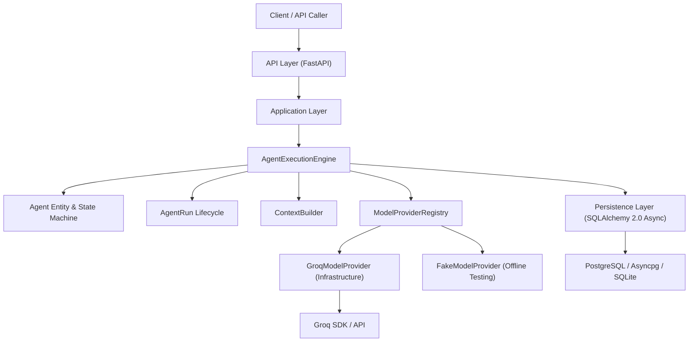
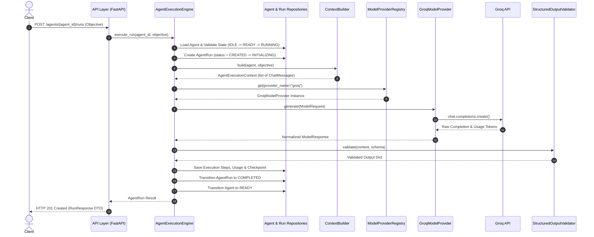

# Agent Runtime Foundation Architecture (Phase 1)

## Overview

The **Agent Runtime Foundation** forms the core execution environment of the Autonomous AI Organization Platform. It enforces the fundamental architectural principle:

> **THE LLM IS NOT THE AGENT.**
> An LLM is a model provider capability used by the Agent Runtime. The authoritative state and organizational truth belong strictly to the Agent Runtime and Company OS.

---

## Architectural Boundary



---

## Execution Sequence



---

## Component Specifications

### 1. Agent Domain Entity & State Machine
- **Identity**: Stable string ID (e.g. `employee_001`).
- **State Machine**: `IDLE` → `READY` → `RUNNING` → `WAITING` | `BLOCKED` → `COMPLETED` | `FAILED` | `CANCELLED`. Validated by `VALID_AGENT_TRANSITIONS`.

### 2. AgentRun & Execution Steps
- **AgentRun Statuses**: `CREATED` → `INITIALIZING` → `RUNNING` → `WAITING` → `COMPLETED` | `FAILED` | `CANCELLED`.
- **Execution Steps**:
  1. `INITIALIZE`: Validates agent state and creates execution scope.
  2. `BUILD_CONTEXT`: Assembles identity, role instructions, constraints, and reference data.
  3. `MODEL_CALL`: Resolves model provider and executes LLM generation.
  4. `VALIDATE_RESPONSE`: Validates response string against expected Pydantic or JSON schemas.
  5. `FINALIZE`: Persists execution result, updates token usage, and resets agent state.

### 3. Model Provider Abstraction & Groq Provider
- **Interface**: `ModelProviderInterface.generate(request: ModelRequest) -> ModelResponse`.
- **Groq Integration**: `GroqModelProvider` located in `src/infrastructure/providers/groq_provider.py`. Uses `groq.AsyncGroq` SDK, configured via `GROQ_API_KEY` and `GROQ_MODEL`.
- **Response Normalization**: All responses return standardized `ModelResponse` with `UsageInfo(input_tokens, output_tokens, total_tokens)`.

### 4. Resilient Error Handling & Retry Policy
- **Transient Errors (Retryable)**: `TimeoutError`, `RateLimitError`, `ProviderUnavailableError`. Executed with bounded exponential backoff via `RetryPolicy`.
- **Non-Retryable Errors**: `AuthenticationError`, `CancellationError`, `ConfigurationError`, `StructuredOutputValidationError`. Fails immediately with clear diagnostic exception.

### 5. Checkpointing & Cancellation
- **Checkpointing**: Every step persists state snapshot via `AgentCheckpoint` into `agent_checkpoints` table.
- **Cancellation**: Safely cancels in-flight runs via `cancel_run(run_id)`, updating `AgentRun` to `CANCELLED` and resetting `Agent` to `READY`.

---

## Local Development & Testing

### 1. Running Unit & Integration Tests
```bash
pytest
```

### 2. Running Failure-Injection Tests
```bash
pytest tests/failure_injection
```

### 3. Running Phase 1 Demonstration Scripts
```bash
# End-to-end Research Agent demo
python scripts/demo_research_agent.py

# Resilience & failure recovery demo
python scripts/demo_failure_recovery.py
```

### 4. Running the API Server
```bash
uvicorn src.api.main:app --reload --port 8000
```
