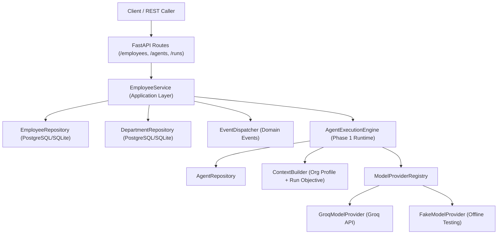

# Autonomous AI Organization Platform Architecture

## Core Architectural Principle

$$\text{EMPLOYEE} \neq \text{AGENT} \neq \text{LLM}$$

1. **Employee**: Represents organizational identity, corporate role, department membership, skills, capabilities, responsibilities, manager delegation hierarchy, and lifecycle state (`INACTIVE`, `ACTIVE`, `ON_LEAVE`, `SUSPENDED`, `TERMINATED`).
2. **Agent**: Represents execution capabilities, permission profile, model configuration, and state machine (`IDLE` → `READY` → `RUNNING`). An Employee delegates work to an Agent.
3. **LLM**: A model provider capability (e.g. Groq `llama-3.3-70b-versatile`) invoked by the Agent Runtime engine. The authoritative state and organizational truth belong strictly to the Agent Runtime and Company OS.

---

## System Architectural Boundary (Phase 1 & Phase 2)



---

## Phase 2 Component Specifications

### 1. Employee Domain Entity & Lifecycle State Machine
- **Identity**: `id` (UUID/slug), `employee_code` (e.g. `EMP-001`), `name`, `title`, `role`, `agent_id`, `department_id`, `manager_id`.
- **Skills & Capabilities**: `EmployeeSkill(name, category, proficiency)`, `EmployeeCapability(name, description)`.
- **Lifecycle States**:
  - `INACTIVE`: Newly onboarded; cannot execute work.
  - `ACTIVE`: Fully operational; authorized to execute work.
  - `ON_LEAVE`: Temporarily unavailable; execution blocked.
  - `SUSPENDED`: Temporarily halted by governance; execution blocked.
  - `TERMINATED`: Offboarded terminal state; cannot transition to any active state.
- **State Machine Guardrails**: Validated by `VALID_EMPLOYEE_TRANSITIONS` and `emp.is_executable()`. Self-manager assignment forbidden (`manager_id != id`).

### 2. Employee Application Service (`EmployeeService`)
- Integrates Employee management with Phase 1 `AgentExecutionEngine`.
- Constructs rich organizational context (`ContextItem` priority 2) containing title, role, skills, capabilities, and responsibilities, passing it into `AgentExecutionEngine.execute_run(...)`.
- Enforces active status guardrail before delegating to `AgentExecutionEngine`.

### 3. Department Entity & Repositories
- `Department`: `id`, `code`, `name`, `description`, `manager_id`, `parent_department_id`.
- Repositories: `SQLAlchemyEmployeeRepository` and `SQLAlchemyDepartmentRepository`.

### 4. YAML Configuration Loaders
- `load_employee_from_yaml`: Parses employee definition files (`config/employees/*.yaml`), expanding nested skills, capabilities, and responsibilities into domain entities.

### 5. Domain Events & Event Dispatcher
- Events: `EmployeeCreatedEvent`, `EmployeeStatusChangedEvent`, `EmployeeManagerAssignedEvent`, `EmployeeDepartmentAssignedEvent`, `EmployeeWorkExecutedEvent`.
- `EventDispatcher`: In-memory async pub/sub dispatcher for domain event subscribers.

### 6. REST API Endpoints (`src/api/routes/employees.py`)
- `POST /employees`: Register employee.
- `GET /employees/{id}`: Retrieve employee details.
- `GET /employees`: List all employees.
- `PATCH /employees/{id}`: Update manager or department assignment.
- `POST /employees/{id}/status`: Transition employee lifecycle state.
- `POST /employees/{id}/runs`: Trigger organizational work execution.

---

## Local Development & Testing

### 1. Running Unit & Integration Tests
```bash
pytest
```

### 2. Running Failure-Injection Tests
```bash
pytest tests/failure_injection
```

### 3. Running Phase 1 & Phase 2 Demonstration Scripts
```bash
# Phase 1: End-to-end Research Agent demo
python scripts/demo_research_agent.py

# Phase 1: Resilience & failure recovery demo
python scripts/demo_failure_recovery.py

# Phase 2: Employee Framework execution demo
python scripts/demo_employee_execution.py

# Phase 2: Employee governance & resilience demo
python scripts/demo_employee_resilience.py
```

### 4. Running the API Server
```bash
uvicorn src.api.main:app --reload --port 8000
```
