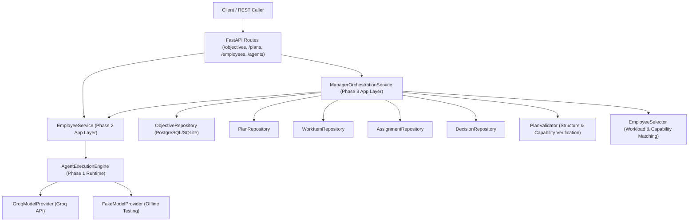
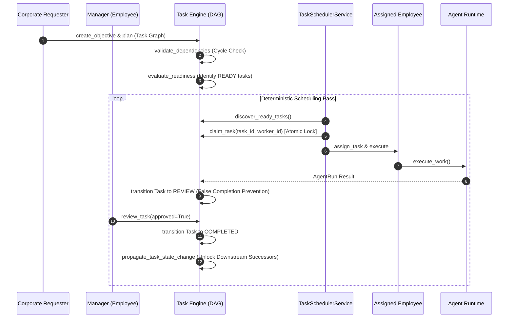

# Autonomous AI Organization Platform Architecture

## Core Architectural Principle

$$\text{EMPLOYEE} \neq \text{AGENT} \neq \text{LLM}$$

1. **Employee**: Represents organizational identity, corporate role, department membership, skills, capabilities, responsibilities, manager delegation hierarchy, and lifecycle state (`INACTIVE`, `ACTIVE`, `ON_LEAVE`, `SUSPENDED`, `TERMINATED`).
2. **Agent**: Represents execution capabilities, permission profile, model configuration, and state machine (`IDLE` → `READY` → `RUNNING`). An Employee delegates work to an Agent.
3. **LLM**: A model provider capability (e.g. Groq `llama-3.3-70b-versatile`) invoked by the Agent Runtime engine. The authoritative state and organizational truth belong strictly to the Agent Runtime and Company OS.

---

## Phase 3 Organizational Orchestration Architectural Boundary



---

---

## Phase 4 Chain of Command Flow

$$\text{Objective} \rightarrow \text{Plan} \rightarrow \text{Task Graph} \rightarrow \text{Readiness Evaluator} \rightarrow \text{READY Tasks} \rightarrow \text{Scheduler} \rightarrow \text{Assignment} \rightarrow \text{Employee} \rightarrow \text{AgentRun} \rightarrow \text{Review}$$



---

## Phase 3 Component Specifications

### 1. Domain Entities & State Machines
- **Objective**: Corporate goal entity (`RECEIVED` → `CLARIFICATION_REQUIRED` → `CLARIFYING` → `READY_FOR_PLANNING` → `PLANNING` → `PLANNED` → `EXECUTING` → `REVIEWING` → `COMPLETED` / `FAILED` / `CANCELLED`).
- **Plan**: Decomposed execution strategy (`DRAFT` → `PROPOSED` → `VALIDATED` → `APPROVED` → `REJECTED` → `EXECUTING` → `REPLANNING` → `COMPLETED`).
- **WorkItem**: Atomically scoped task unit (`PLANNED` → `ASSIGNED` → `IN_PROGRESS` → `REVIEWING` → `COMPLETED` / `BLOCKED` / `CANCELLED`).
- **Assignment**: Allocation record connecting WorkItem to an active Employee (`ACTIVE`, `INACTIVE`, `REASSIGNED`, `COMPLETED`, `CANCELLED`).
- **ManagerDecision**: Audited record of managerial choices (`APPROVE_PLAN`, `REJECT_PLAN`, `ASSIGN_WORK`, `REASSIGN_WORK`, `CLARIFY_OBJECTIVE`, `RESOLVE_BLOCKER`, `ESCALATE`, `APPROVE_RESULT`).

### 2. Manager Role Capabilities & Hierarchy Cycle Detection
- **Manager Authority**: `emp.is_manager()` evaluates title/role keywords (`manager`, `lead`, `director`, `chief`, `head`) or managerial capabilities (`planning`, `task_decomposition`, `approval`).
- **Hierarchy Cycle Prevention**: `EmployeeService.update_manager(employee_id, manager_id)` performs graph traversal to detect and reject direct (`A → B → A`), transitive (`A → B → C → A`), or self-management (`A → A`) cycles via `EmployeeValidationError`.

### 3. Application Services
- **`ManagerOrchestrationService`**: Coordinates objective lifecycle, ambiguity clarification, LLM plan submission, manager approval, work item assignment, blocker resolution, and decision audit logging.
- **`PlanValidator`**: Validates structural plan rules (non-empty work items, unique IDs, non-empty capability specifications).
- **`EmployeeSelector`**: Matches active employees against required work item capabilities and selects candidate workers.

### 4. REST API Endpoints (`src/api/routes/objectives.py`)
- `POST /objectives`: Create organizational objective.
- `GET /objectives/{id}`: Retrieve objective details.
- `POST /objectives/{id}/clarification/request`: Request ambiguity clarification.
- `POST /objectives/{id}/clarification/provide`: Provide clarification answers.
- `POST /objectives/{id}/plans`: Submit proposed plan with work items.
- `POST /objectives/plans/{plan_id}/approve`: Manager approves proposed plan.
- `POST /objectives/work-items/{work_item_id}/assign`: Assign work item to employee.
- `POST /objectives/work-items/{work_item_id}/blocker`: Report work item blocker.
- `POST /objectives/work-items/{work_item_id}/reassign`: Manager reassigns blocked work item.
- `POST /objectives/work-items/{work_item_id}/escalate`: Escalate blocker to higher management.

---

## Local Development & Testing

### 1. Running Test Suite (141 Tests)
```bash
pytest
```

### 2. Running Failure-Injection Test Suite
```bash
pytest tests/failure_injection
```

### 3. Running Phase 3 Demonstration Scripts
```bash
# Phase 3: End-to-end manager objective decomposition & orchestration demo
python scripts/demo_manager_orchestration.py

# Phase 3: Manager guardrails, hierarchy cycle detection & resilience demo
python scripts/demo_manager_resilience.py
```

### 4. Running the API Server
```bash
uvicorn src.api.main:app --reload --port 8000
```
