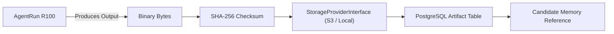

# Phase 7 — Artifact System Architecture

## Overview & Core Principles

The Phase 7 Artifact System introduces first-class versioned file and output management to the platform. It separates metadata persistence from binary content storage.

$$\text{ARTIFACT} \neq \text{WORKSPACE} \neq \text{MEMORY}$$

### Key Invariants
1. **Separation of Metadata and Storage**: Artifact metadata (name, checksum, size, version, provenance) is stored in PostgreSQL, while raw binary payloads are managed via `StorageProviderInterface` (local disk or MinIO/S3 object storage).
2. **Deterministic Versioning**: Modifying an artifact produces a new version (`version = v_n + 1`) while transitioning the prior version to `SUPERSEDED`. Historical versions remain accessible and immutable.
3. **Integrity Validation**: SHA-256 checksums are calculated upon artifact payload creation and versioning to guarantee byte-level data integrity.
4. **Full Provenance Tracing**: Artifacts track their originating `created_by_employee_id`, `source_run_id`, `task_id`, and workspace context.

---

## Artifact Domain Schema

```
Artifact
 ├── id: str
 ├── workspace_id: str
 ├── name: str
 ├── mime_type: str
 ├── size_bytes: int
 ├── checksum_sha256: str
 ├── version: int
 ├── created_by_employee_id: str
 ├── source_run_id: str | None
 ├── task_id: str | None
 ├── status: ArtifactStatus (CREATED, ACTIVE, SUPERSEDED, ARCHIVED, DELETED)
 ├── storage_key: str
 ├── metadata: dict
 └── created_at / updated_at
```

---

## Storage & Provenance Pipeline


