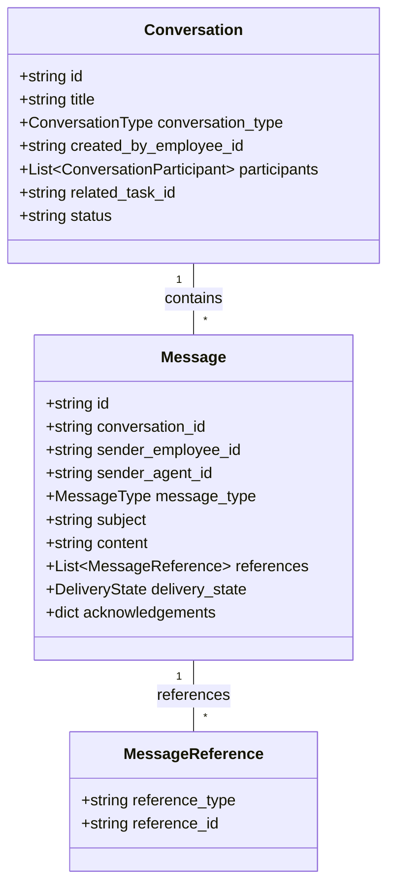
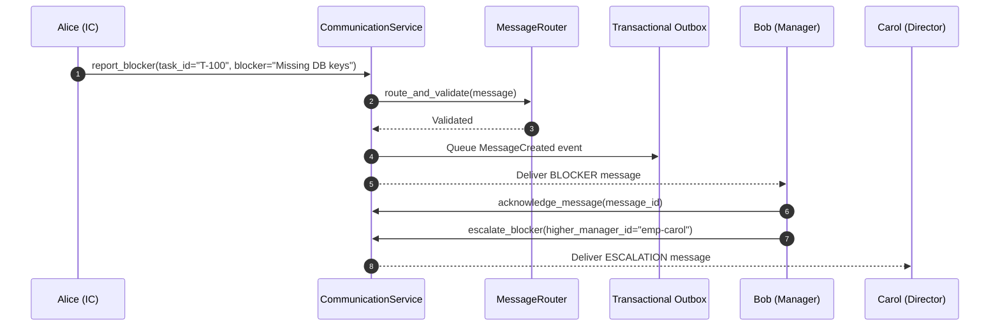

# Communication & Collaboration Protocol Architecture (Phase 5)

## Overview

The **Communication & Collaboration Protocol** introduces a structured, auditable organizational message transport layer into the Autonomous AI Company Platform. Communication is treated as an organizational protocol, not merely a chat UI.

The platform enforces the critical identity invariant:

$$\text{EMPLOYEE} \neq \text{AGENT} \neq \text{LLM}$$

- **Employee**: Organizational identity (who sent/received the message).
- **Agent**: Execution identity (agent instance acting on behalf of an employee).
- **LLM**: Model capability (model provider execution engine).

---

## Target Architectural Execution Chain

$$\text{Objective} \longrightarrow \text{Plan} \longrightarrow \text{Task Graph} \longrightarrow \text{Assignment} \longrightarrow \text{Employee} \stackrel{\text{Communication Protocol}}{\longleftrightarrow} \text{Agent Runtime}$$

---

## Core Domain Entities

---

## Architectural Principles & Invariants

1. **Backend Sender Authority**: Sender identity is strictly verified against caller authentication (`MessageRouter`). Sender spoofing and terminated employee messaging are rejected.
2. **Task Engine State Authority**: Communication reports information (e.g. `BLOCKER`, `STATUS_UPDATE`). The Task Engine remains authoritative for `TaskStatus` transitions (`READY`, `BLOCKED`, `COMPLETED`).
3. **Transactional Outbox**: Message creation persists outbox records (`outbox_messages`) in the same database transaction, ensuring reliable asynchronous delivery.
4. **Prompt Injection Boundary**: `MessageContextBuilder` frames injected message context with explicit `UNTRUSTED USER CONTENT` security boundaries, preventing message content from overriding system instructions.

---

## Sequence: Blocker Reporting & Escalation

