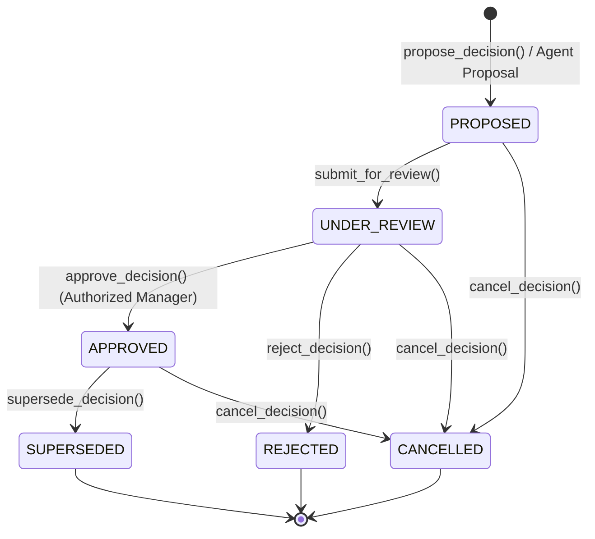
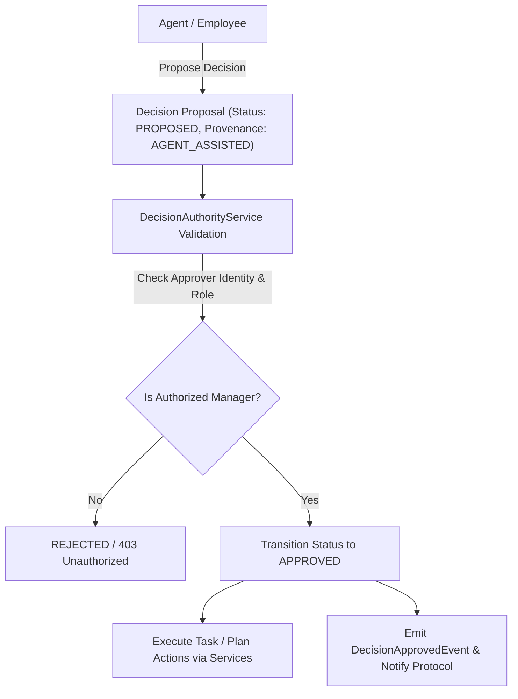

# Phase 6 — Decision Management Architecture

## 1. Domain Overview & LLM Authority Boundaries

A **Decision** is an authoritative organizational record capturing decision question, options, chosen option, rationale, consequences, evidence, meeting/task/objective references, authority role, and provenance.

Key Invariants:
1. **$\text{Message} \neq \text{Decision}$**: Messages represent communication. Decisions represent authoritative organizational truth.
2. **LLM Authority Boundary**:
   - LLMs / Agents may analyze options and submit **Decision Proposals** (`status = PROPOSED`, `provenance = AGENT_ASSISTED`).
   - LLMs / Agents **CANNOT** approve decisions or declare them authoritative.
   - Approval is strictly reserved for authorized Human / Employee Managers verified by `DecisionAuthorityService`.
3. **Decision Immutability & Supersession**:
   - Approved Decisions are immutable.
   - Changing an approved decision requires creating a new Decision `D2` and explicitly superseding `D1` (`D1` becomes `SUPERSEDED`, `D2` becomes `APPROVED`). `D1` remains historically accessible.
4. **Task/Plan Integration via Services**:
   - Approved decisions trigger Task or Plan actions strictly through `TaskService` and `ManagerOrchestrationService` (never via direct database state mutations).

## 2. Decision Lifecycle Diagram

## 3. Decision Provenance & Authority Flow Diagram

