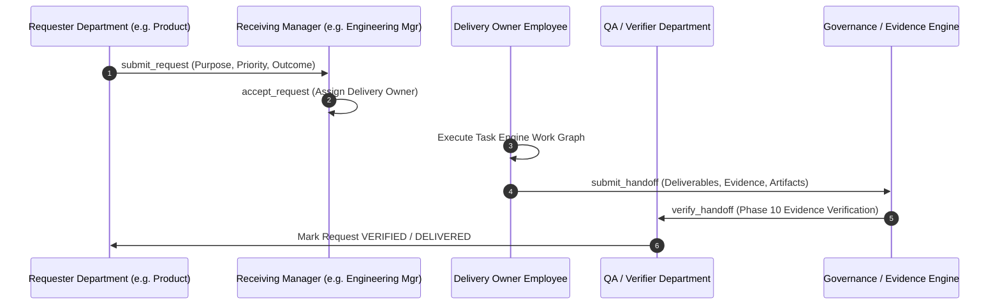

# Phase 14 Architecture — Department Expansion, Enterprise Operating Functions & Cross-Department Collaboration

## Core Architectural Principle

Departments are organizational boundaries operating on the unified Company OS.

```
Company
    ↓
Departments
    ↓
Managers
    ↓
Employees
    ↓
Agents
    ↓
Tasks
    ↓
Tools
    ↓
Evidence
    ↓
Verification
```

**DEPARTMENTS PROVIDE SPECIALIZATION. COMPANY OS PROVIDES COORDINATION.**

Departments are **NOT** separate applications, separate agent runtimes, separate task engines, separate governance systems, or separate memory systems. All 13 enterprise operating departments (Executive, Product, Engineering, QA, DevOps, Research, Marketing, Sales, Customer Success, Finance, Legal, HR, Operations) run on the unified Company OS infrastructure.

---

## Enterprise Department Set

| Department | Code | Core Purpose | Capabilities |
| :--- | :--- | :--- | :--- |
| **Executive & Management** | `EXEC` | Strategic direction, corporate governance, company decisions | `EXECUTIVE_DECISION`, `STRATEGIC_PLANNING` |
| **Product Management** | `PROD` | Product vision, roadmap, requirements definition | `PRODUCT_STRATEGY`, `REQUIREMENTS_DEFINITION` |
| **Engineering** | `ENG` | Software architecture, implementation, code review | `SOFTWARE_DEVELOPMENT`, `SYSTEM_ARCHITECTURE` |
| **Quality Assurance** | `QA` | Testing, evidence verification, defect tracking | `TESTING`, `QUALITY_VERIFICATION` |
| **DevOps & Infrastructure** | `DEVOPS` | Cloud platforms, CI/CD pipelines, production deployment | `INFRASTRUCTURE_MANAGEMENT`, `DEPLOYMENT` |
| **Marketing** | `MKT` | Market research, branding, campaigns, content creation | `MARKET_RESEARCH`, `CONTENT_CREATION` |
| **Sales** | `SALES` | Lead qualification, customer proposals, enterprise pipeline | `LEAD_QUALIFICATION`, `PROPOSAL_GENERATION` |
| **Customer Success** | `CS` | Client onboarding, issue resolution, customer retention | `CUSTOMER_SUPPORT`, `CLIENT_ONBOARDING` |
| **Finance** | `FIN` | Financial analysis, budgeting, cost reporting, billing | `FINANCIAL_ANALYSIS`, `BUDGETING` |
| **Legal & Compliance** | `LEG` | Contract review, compliance audit, legal risk policy | `CONTRACT_REVIEW`, `COMPLIANCE_ANALYSIS` |
| **Human Resources** | `HR` | Talent acquisition, skills mapping, team culture | `TALENT_ACQUISITION`, `SKILLS_MAPPING` |
| **Research** | `RES` | Technology research, AI model exploration, innovation | `AI_RESEARCH`, `FEASIBILITY_ANALYSIS` |
| **Operations** | `OPS` | Process optimization, logistics, resource management | `PROCESS_OPTIMIZATION`, `RESOURCE_MANAGEMENT` |

---

## Cross-Department Collaboration Control Flow



---

## Cross-Department Ownership & Reliability Rules

1. **Explicit Ownership Matrix**:
   - **Requester**: Originating department employee.
   - **Accountable Manager**: Receiving department manager accountable for SLA & delivery.
   - **Delivery Owner**: Designated employee executing the deliverable tasks.
2. **Phase 10 Evidence Verification**: Cross-department handoffs **MUST** pass formal evidence verification before being marked `VERIFIED` or `DELIVERED`. Senders cannot complete cross-department requests by simple unverified claim.
3. **Department Health Evaluation**: Calculated deterministically based on real Task Engine metrics (`active_tasks`, `completed_tasks`, `blocked_tasks`, `escalation_rate`, `downstream_congestion_bottleneck`).
