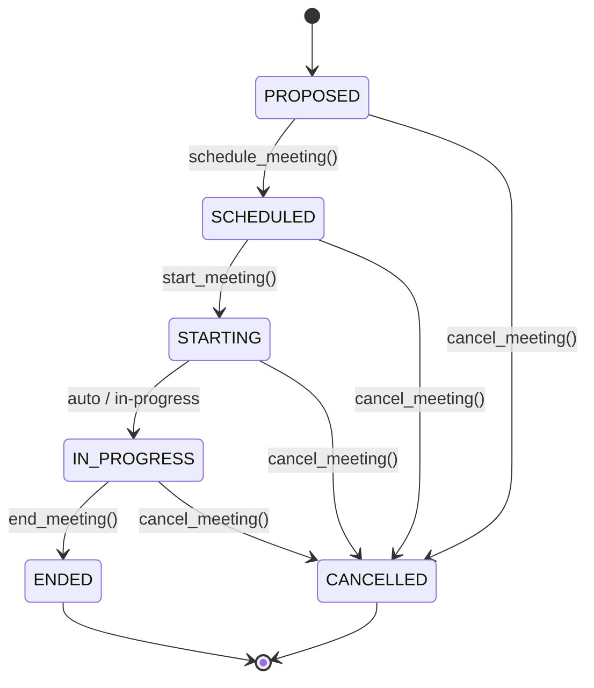

# Phase 6 — Meetings Architecture

## 1. Domain Overview & Invariants

A **Meeting** represents an authoritative organizational collaboration event with a defined purpose, organizer, participants, agenda, lifecycle status, context, and decisions.

Key Invariants:
1. **$\text{Meeting} \neq \text{Conversation}$**: A Meeting is not just a chat thread. It represents a structured event with an agenda, scheduled time range, attendance records, and explicit lifecycle states.
2. **Conversation Linkage**: A Meeting references a Phase 5 `Conversation` via `conversation_id`. Messages sent within the meeting utilize the Phase 5 Communication Protocol.
3. **Backend Lifecycle Ownership**: State transitions (`PROPOSED` $\rightarrow$ `SCHEDULED` $\rightarrow$ `STARTING` $\rightarrow$ `IN_PROGRESS` $\rightarrow$ `ENDED` / `CANCELLED`) are strictly owned by `MeetingSchedulingService` and domain logic.
4. **Attendance vs. Participation**: Participation invitations (`ORGANIZER`, `REQUIRED`, `OPTIONAL`, `OBSERVER`, `PRESENTER`) are tracked separately from attendance status (`INVITED`, `ACCEPTED`, `DECLINED`, `ATTENDED`, `ABSENT`).
5. **Untrusted Context Framing**: Meeting context is formatted with security framing (`=== BEGIN UNTRUSTED MEETING CONTEXT ===`) to prevent prompt injection from message text into LLM system definitions.

## 2. Meeting Lifecycle Diagram

## 3. Core Entities

- **`Meeting`**: Main aggregate root holding purpose, organizer, status, scheduled/actual time range, conversation/objective/task references.
- **`MeetingParticipant`**: Explicit participant record with employee ID, role, and optional bound Agent ID.
- **`MeetingAttendance`**: Recorded attendance state (`ATTENDED`, `ABSENT`, `ACCEPTED`, `DECLINED`).
- **`AgendaItem`**: Deterministically ordered agenda item with title, owner, duration, and objective/task links.
- **`MeetingTranscript`**: Auditable record preserving speaker identities and timestamps.
