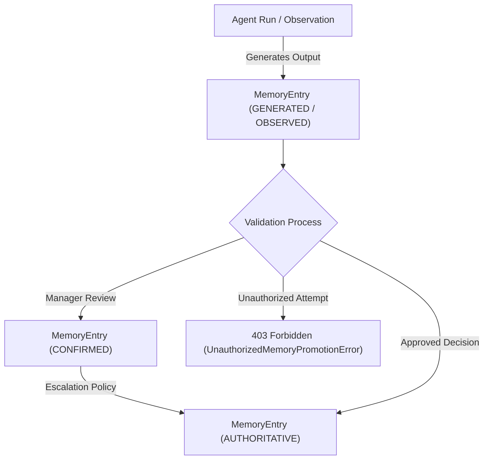

# Phase 7 — Memory System Architecture

## Overview & Core Principles

The Phase 7 Memory System introduces durable organizational knowledge management to the Autonomous AI Organization Platform. It enforces the fundamental architectural principle:

$$\text{EMPLOYEE} \neq \text{AGENT} \neq \text{LLM} \neq \text{MEMORY}$$

### Key Invariants
1. **Backend-Controlled Memory Authority**: LLMs cannot automatically generate authoritative organizational truth. Model outputs are created with `authority = GENERATED` or `OBSERVED`.
2. **Authority Escalation Policy**: Promotion to `AUTHORITATIVE` memory requires explicit approval by an authorized Manager/Lead or derivation from an approved organizational `Decision`.
3. **History Preservation**: Knowledge changes use state-machine driven supersession (`SUPERSEDED` state) rather than destructive in-place overwrites. Historical memory entries remain accessible for audit trace and provenance.
4. **Scope-Based Access Control**: Memory retrieval enforces strict boundaries across `RUN`, `TASK`, `EMPLOYEE`, `PROJECT`, `DEPARTMENT`, and `COMPANY` scopes.
5. **Prompt Security Framing**: Retrieved memory is injected into Agent execution contexts wrapped in prompt isolation boundaries (`=== BEGIN UNTRUSTED ORGANIZATIONAL MEMORY CONTEXT ===`) to prevent prompt injection attacks.

---

## Memory Entry Domain Schema

```
MemoryEntry
 ├── id: str
 ├── memory_type: MemoryType (WORKING, EPISODIC, SEMANTIC, PROCEDURAL, ORGANIZATIONAL)
 ├── scope: MemoryScope (RUN, TASK, EMPLOYEE, PROJECT, DEPARTMENT, COMPANY)
 ├── owner_id: str
 ├── content: str
 ├── summary: str | None
 ├── authority: MemoryAuthority (UNVERIFIED, OBSERVED, GENERATED, CONFIRMED, AUTHORITATIVE)
 ├── confidence: float [0.0, 1.0]
 ├── provenance: MemoryProvenance (AGENT_RUN, MESSAGE, MEETING, DECISION, TASK, ARTIFACT, EMPLOYEE, SYSTEM_EVENT)
 ├── status: MemoryStatus (ACTIVE, SUPERSEDED, ARCHIVED, INVALIDATED)
 ├── previous_memory_id: str | None
 ├── source_id / objective_id / plan_id / task_id / employee_id / agent_run_id / meeting_id / decision_id / artifact_id
 └── created_at / updated_at
```

---

## Authority Promotion Workflow



---

## Hybrid Retrieval & Context Construction

The `MemoryRetrievalService` executes hybrid scoring combining authority weighting, semantic cosine similarity (via `EmbeddingProviderInterface` / pgvector), confidence, and recency:

$$\text{Score} = (\text{Authority Weight}) + (\text{Cosine Similarity} \times 5.0) + (\text{Confidence} \times 2.0)$$

where Authority Weights are:
- `AUTHORITATIVE`: +10.0
- `CONFIRMED`: +8.0
- `OBSERVED`: +5.0
- `GENERATED`: +3.0

If embedding generation or vector similarity fails, retrieval gracefully falls back to structured metadata filtering without throwing runtime exceptions.
