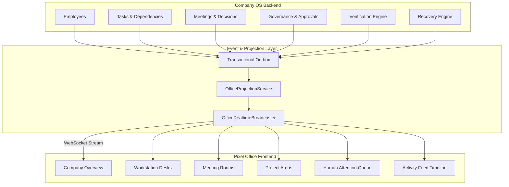

# Phase 13 Architecture — Pixel Office, Organizational Visualization & Real-Time Company Simulation

## Core Architectural Principle

The Pixel Office is **NOT** the Company OS, an agent runtime, or a fake simulation engine that invents activity.

```
Company OS (Backend)
    ↓
Authoritative State
    ↓
Event / State Projection
    ↓
Pixel Office
    ↓
Visualization
```

**THE COMPANY OS IS REALITY. THE PIXEL OFFICE VISUALIZES REALITY.**

Every visual state displayed in the Pixel Office (Working, In Meeting, Blocked, Reviewing, Recovering, Paused, Awaiting Approval) is deterministically projected from real backend events and database records.

---

## Visual State Projection Rules

| Visual State | Authoritative Backend Condition |
| :--- | :--- |
| `PAUSED` | Phase 11 Governance Emergency Stop or Autonomy Pause is active. |
| `RECOVERING` | Phase 10 Recovery Engine is executing active recovery action. |
| `AWAITING_APPROVAL` | Phase 11 Governance Approval Request is PENDING for employee/task. |
| `REVIEWING` | Phase 10 Verification Engine is running checks on task output. |
| `BLOCKED` | Phase 4 Task Engine reports active task dependency blocker. |
| `IN_MEETING` | Phase 6 Meeting Engine indicates employee in active meeting room. |
| `WORKING` | Phase 1 AgentRun or Phase 4 Task execution is IN_PROGRESS. |
| `IDLE` | Employee is ACTIVE with no current execution, meeting, or blocker. |
| `OFFLINE` | Employee status is INACTIVE or OFFLINE. |

---

## Architecture Diagram



---

## Security, Privacy & Data Isolation

1. **Authorization Scopes**: Client WebSocket connections filter real-time state events according to the user's authorized department and project scopes.
2. **Secret Non-Leakage**: Internal credentials, API keys, bearer tokens, private prompts, and restricted artifacts are strictly stripped before projections reach the presentation layer.
3. **Command Control Flow**: UI interactions (e.g. clicking "Approve" or "Emergency Stop") execute through authoritative backend service APIs (`GovernanceService`) rather than mutating presentation state directly.
