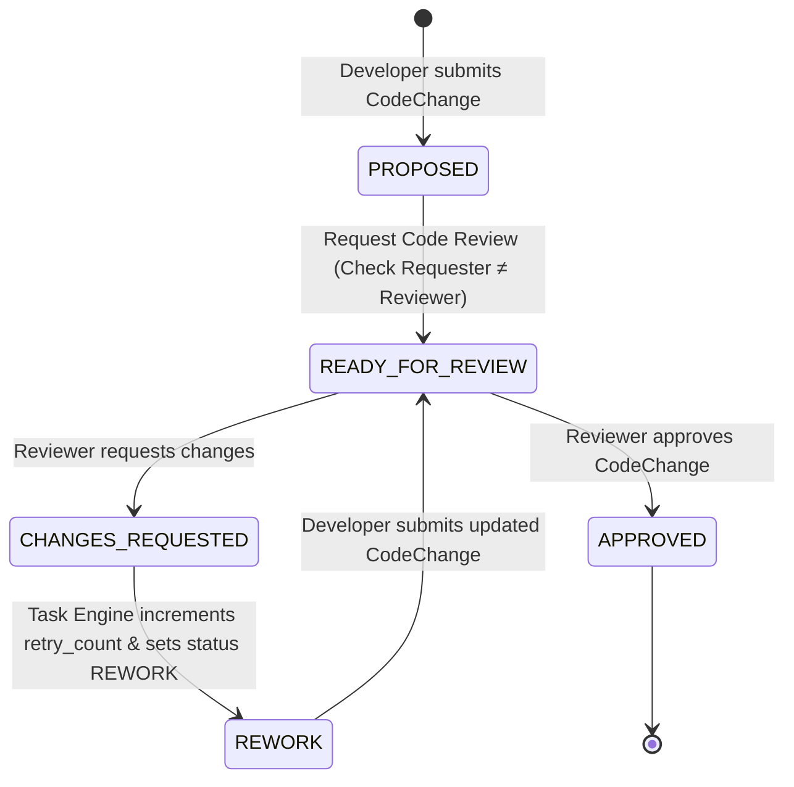
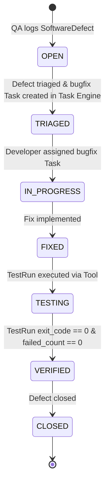

# Phase 9 — AI Software Company Architecture

## Overview & Core Principles

Phase 9 implements the first complete domain-specific autonomous organization workflow on the platform: **An AI Software Company**.

It translates a high-level product objective into a fully analyzed, planned, implemented, tested, code-reviewed, evidence-backed, and delivered software solution, operating strictly through the Company OS architecture established in Phases 1–8.

$$\text{Company Objective} \rightarrow \text{Engineering Manager} \rightarrow \text{Requirements} \rightarrow \text{Engineering Plan} \rightarrow \text{Task Graph} \rightarrow \text{Employee Assignment} \rightarrow \text{Workspace} \rightarrow \text{Tool Execution} \rightarrow \text{Test Execution} \rightarrow \text{Code Review} \rightarrow \text{Rework (if required)} \rightarrow \text{Evidence} \rightarrow \text{Delivery}$$

---

## 1. End-to-End Software Engineering Workflow

```mermaid
flowchart TD
    Obj["Company Software Objective"] --> Mgr["Engineering Manager"]
    Mgr --> Req["Requirements Analysis & Acceptance Criteria"]
    Req --> Plan["Engineering Plan & Architecture Overview"]
    Plan --> TaskEngine["Phase 4 Task Dependency Engine (DAG Decomposition)"]
    TaskEngine --> Select["Capability-Based Employee Selection (EmployeeSelector)"]
    Select --> Dev["Developer (Task Implementation)"]
    Dev --> WS["Sandboxed Task Workspace (WorkspaceAuthorizationService)"]
    WS --> Tools["Phase 8 Controlled Tool Execution (File, Git)"]
    Tools --> Code["CodeChange Submission"]
    Code --> Reviewer["Code Reviewer (QA / Lead)"]
    Reviewer --> ReviewCheck{"Review Decision"}
    ReviewCheck -->|CHANGES_REQUESTED| Rework["Phase 4 Task REWORK Trigger"]
    Rework --> Dev
    ReviewCheck -->|APPROVED| QATest["QA Test Run (Phase 8 Tool Execution)"]
    QATest --> TestCheck{"Test Execution Evidence"}
    TestCheck -->|FAILED| Defect["Report SoftwareDefect & Bugfix Task"]
    Defect --> Dev
    TestCheck -->|PASSED (exit_code=0)| DeliveryReq["Delivery Request"]
    DeliveryReq --> SelfCheck{"Self-Approval Guard"}
    SelfCheck -->|Requester == Approver| Denied["403 Forbidden"]
    SelfCheck -->|Manager Approved| Delivered["Software Delivered"]
```

---

## 2. Software Engineering Roles & Capabilities

Software employees are represented through the Phase 2 `Employee` framework with specific capabilities:

| Software Role | Role Title Keyword | Machine-Checkable Capabilities Required |
|---|---|---|
| Engineering Manager | Engineering Director / Manager | `planning`, `task_decomposition`, `SOFTWARE_ARCHITECTURE` |
| Software Architect | Principal / System Architect | `SOFTWARE_ARCHITECTURE`, `SOFTWARE_REQUIREMENTS_ANALYSIS` |
| Backend Developer | Senior / Staff Backend Engineer | `BACKEND_DEVELOPMENT`, `GIT_OPERATIONS` |
| Frontend Developer | Frontend Engineer | `FRONTEND_DEVELOPMENT` |
| QA Engineer | QA / Test Engineer | `QA_ENGINEERING`, `CODE_REVIEW` |
| Code Reviewer | Technical Lead / Reviewer | `CODE_REVIEW`, `SOFTWARE_ARCHITECTURE` |

---

## 3. Code Review & QA Rework Loop



---

## 4. Software Defect & Bugfix Task Pipeline



---

## 5. REST API Endpoints (`src/api/routes/software_projects.py`)

- `POST /software-projects`: Create SoftwareProject linked to an Objective.
- `GET /software-projects/{id}`: Retrieve software project details.
- `POST /software-projects/{id}/requirements`: Add structured requirements with acceptance criteria.
- `POST /software-projects/{id}/plan`: Engineering Manager decomposes requirements into Task Graph.
- `GET /software-projects/{id}/status`: Backend-authoritative project status aggregation.
- `POST /code-changes`: Submit CodeChange proposal for a task.
- `POST /code-changes/{id}/review-request`: Request code review (enforces self-approval guard).
- `POST /code-reviews/{id}/findings`: Submit review findings (`APPROVED` or `CHANGES_REQUESTED`).
- `POST /test-runs`: Record tool-executed TestRun evidence.
- `POST /software-projects/{id}/defects`: Log SoftwareDefect and generate bugfix Task.
- `POST /software-projects/{id}/delivery-request`: Request release delivery.
- `POST /software-deliveries/{id}/approve`: Manager approves delivery after evidence verification.
