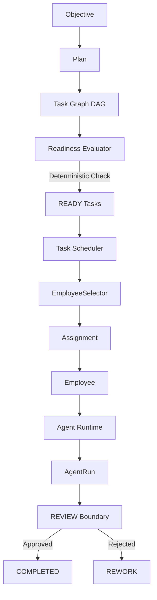
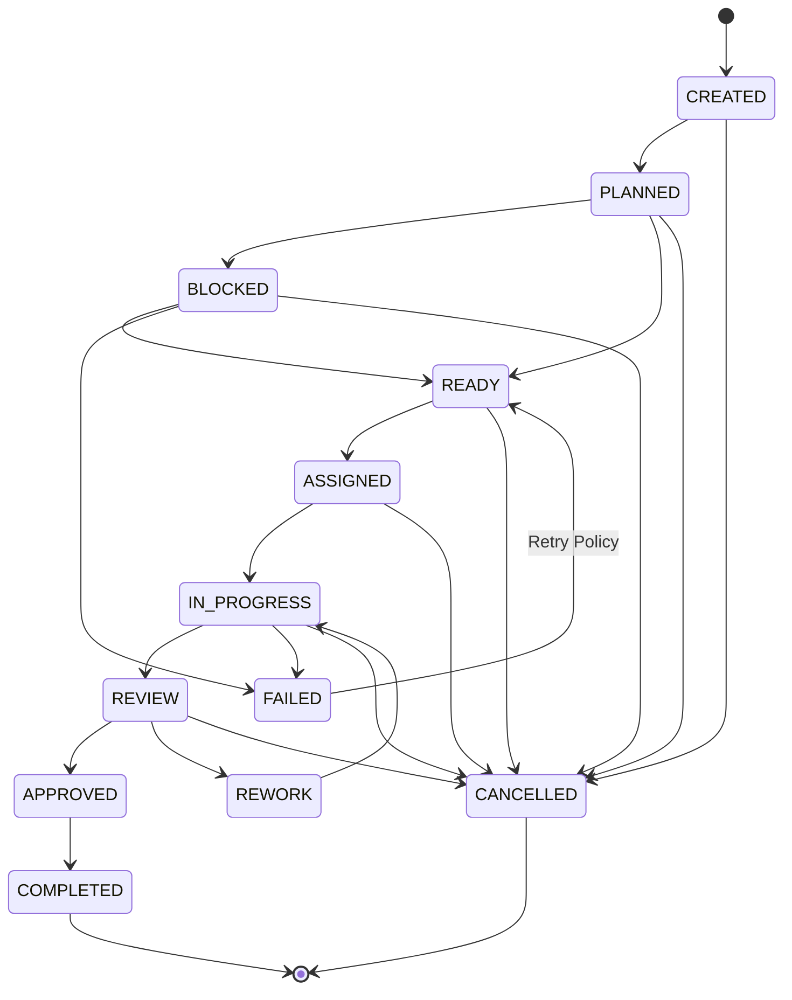
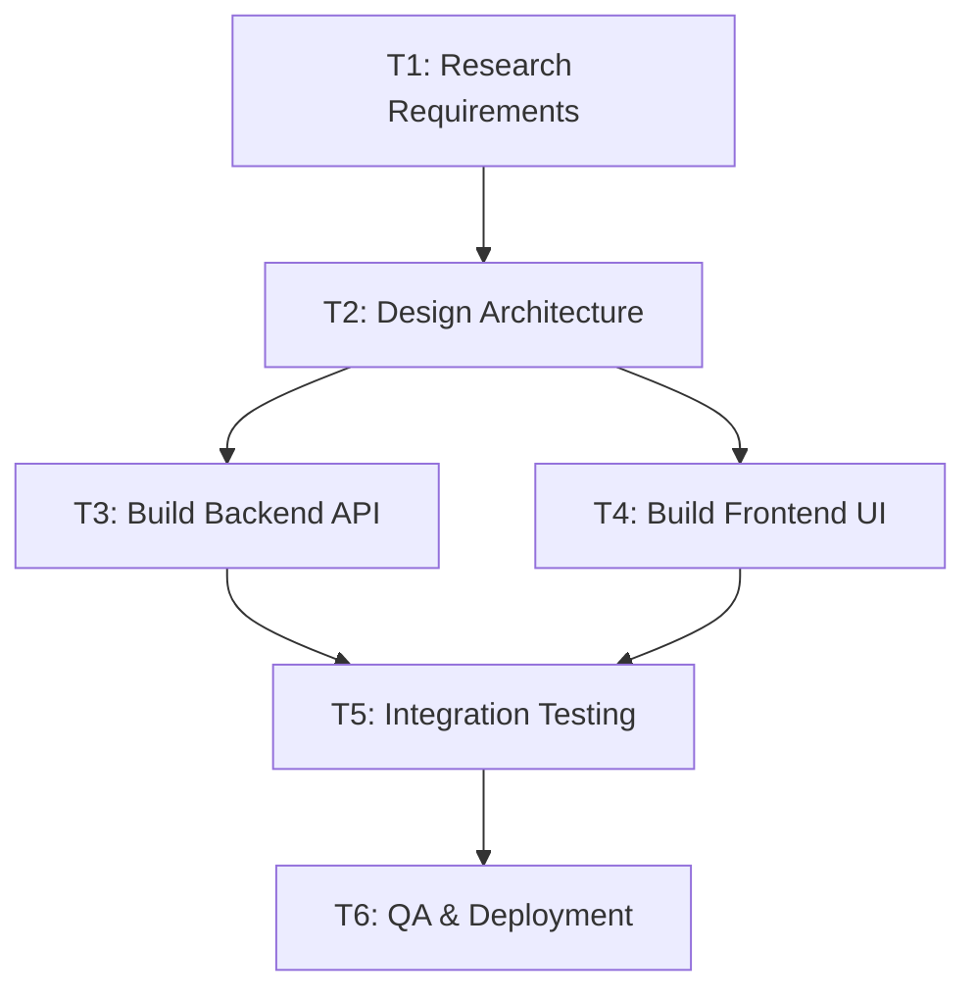

# Phase 4 Architecture — Task & Dependency Engine

The **Task & Dependency Engine** evolves the Autonomous AI Organization Platform from simple plan decomposition into a deterministic, dependency-aware Directed Acyclic Graph (DAG) execution system.

---

## 1. Architectural Principles & Authority Invariants

1. **Deterministic Backend State Authority**: The backend authoritatively owns task state, dependency truth, graph validation, cycle detection, readiness, blocking, task claiming, scheduling eligibility, retry limits, and completion state. The LLM may propose task decompositions and dependency suggestions, but domain rules strictly enforce state changes.
2. **Organizational Chain of Command**:
   $$\text{Objective} \rightarrow \text{Plan} \rightarrow \text{Task Graph} \rightarrow \text{Readiness Evaluator} \rightarrow \text{READY Tasks} \rightarrow \text{Scheduler} \rightarrow \text{Assignment} \rightarrow \text{Employee} \rightarrow \text{AgentRun} \rightarrow \text{Review}$$
3. **No Rebuilding of Previous Phases**: Phase 4 reuses the Phase 1 Agent Runtime, Phase 2 Employee Framework, and Phase 3 Manager Orchestration systems without code duplication.

---

## 2. WorkItem → Task Relationship

- **WorkItem (Phase 3)**: High-level specification created during manager plan decomposition.
- **Task (Phase 4)**: Authoritative execution DAG node inheriting `WorkItem` attributes (title, description, required capabilities, priority) while adding execution graph semantics: `parent_task_id`, `work_item_id`, `retry_count`, `max_retries`, `execution_run_id`, `assignment_id`, and `block_reasons`.

---

## 3. Task Lifecycle State Machine

---

## 4. Dependency Graph & Cycle Detection

### Graph Validation Rules
1. **Self-Dependency Rejection**: `Task A -> Task A` is strictly rejected (`TaskDependencyError`).
2. **Cycle Rejection**: Direct (`A -> B -> A`) and multi-level cycles (`A -> B -> C -> A`) are detected before persistence using in-memory BFS/DFS path checking (`TaskCycleError`). No invalid graph can enter the database.

### DAG Topology Example

---

## 5. False Completion Prevention & REVIEW Boundary

A successful `AgentRun` does NOT automatically mark a `Task` as `COMPLETED`. Instead, execution outcome transitions the task to `REVIEW`. The task reaches `COMPLETED` only after explicit review approval, preserving the boundary for future verification engines.

---

## 6. Resilience & Retry Policy

- **Bounded Task Retries**: Tasks track `retry_count` and `max_retries`. Transient execution errors trigger bounded retry scheduling.
- **Atomic Claiming**: `TaskClaimService` prevents race conditions when concurrent workers attempt to execute the same task.
