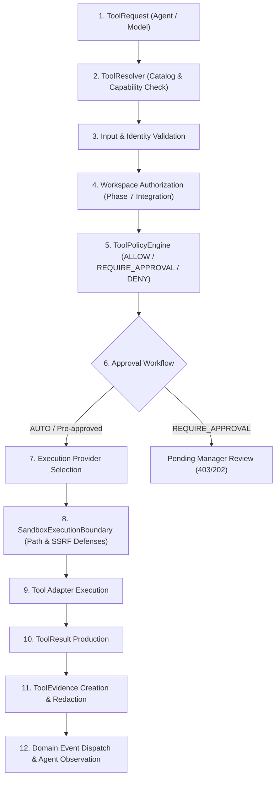

# Phase 8 — Tool & Integration Architecture

## Overview & Core Principles

The Phase 8 Tool & Integration System establishes controlled organizational tool capabilities for the Autonomous AI Organization Platform. It enforces the fundamental architectural principle:

$$\text{THE LLM DOES NOT DIRECTLY EXECUTE TOOLS}$$

$$\text{ModelProvider} \neq \text{AgentProvider} \neq \text{ExecutionProvider} \neq \text{ToolProvider}$$

The LLM proposes a structured `ToolRequest`. The backend resolves, validates, authorizes, checks policy, checks approval, executes in a sandboxed adapter, redacts credentials, records evidence, emits audit events, and returns the result as an observation.

---

## 12-Stage Tool Execution Pipeline

---

## Permission Modes & Policy Engine

1. **AUTO Mode**: Low-risk operations within authorized workspace boundaries (e.g. `READ_FILE`, `WRITE_FILE`, `READ_ARTIFACT`).
2. **APPROVAL Mode**: Consequential actions requiring explicit manager approval (e.g. `SEND_MESSAGE`, `DELETE_FILE`, `CREATE_ARTIFACT_VERSION`). An agent CANNOT approve its own request (`UnauthorizedApprovalError`).
3. **BLOCKED Mode**: Operations strictly prohibited by backend policy (e.g. `DATABASE_WRITE`, `GIT_WRITE` without authority).

---

## Security & Isolation Controls

- **SSRF Defenses (`SandboxExecutionBoundary`)**: Blocks requests to loopback addresses (`127.0.0.1`, `localhost`), private subnets (`10.x.x.x`, `172.16-31.x.x`, `192.168.x.x`), cloud metadata endpoints (`169.254.169.254`), and non-HTTP/HTTPS protocols.
- **Secrets Broker (`SecretsBroker`)**: Ensures raw credentials NEVER enter model context. Credentials are injected at execution time, and raw secret values are automatically redacted from logs, tool results, and evidence.
- **Workspace Isolation (`WorkspaceAuthorizationService`)**: Ensures agents assigned to Task $T1$ cannot access isolated workspace directories owned by Task $T2$.

---

## Adapter Catalog

| Adapter | Capabilities Supported | Integration Point |
|---|---|---|
| `FileToolExecutor` | `READ_FILE`, `WRITE_FILE`, `DELETE_FILE` | Sandboxed Workspace Filesystem |
| `ArtifactToolExecutor` | `READ_ARTIFACT`, `CREATE_ARTIFACT`, `UPDATE_ARTIFACT` | Phase 7 Artifact Repositories & Storage |
| `TaskToolExecutor` | `READ_TASK`, `REPORT_PROGRESS`, `REPORT_BLOCKER`, `UPDATE_TASK` | Phase 4 Task Engine |
| `CommunicationToolExecutor` | `SEND_MESSAGE`, `REPORT_BLOCKER` | Phase 5 Communication Protocol |
| `HTTPToolExecutor` | `HTTP_REQUEST` | Sandboxed `httpx` with SSRF defense & credential injection |
| `BrowserToolExecutor` | `BROWSER_NAVIGATION` | Playwright-ready browser automation session adapter |
| `MCPToolAdapter` | Integration capabilities | Model Context Protocol adapter |
