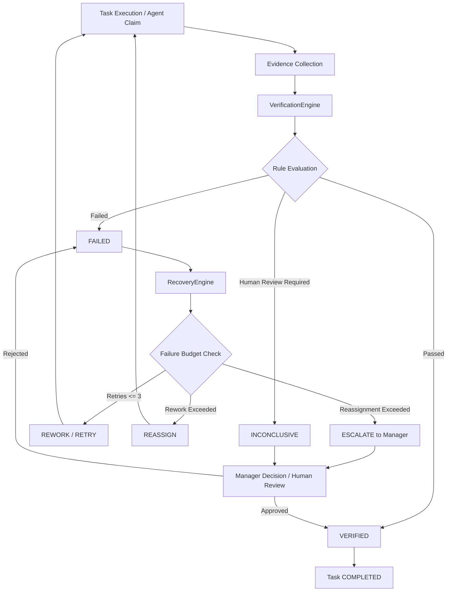
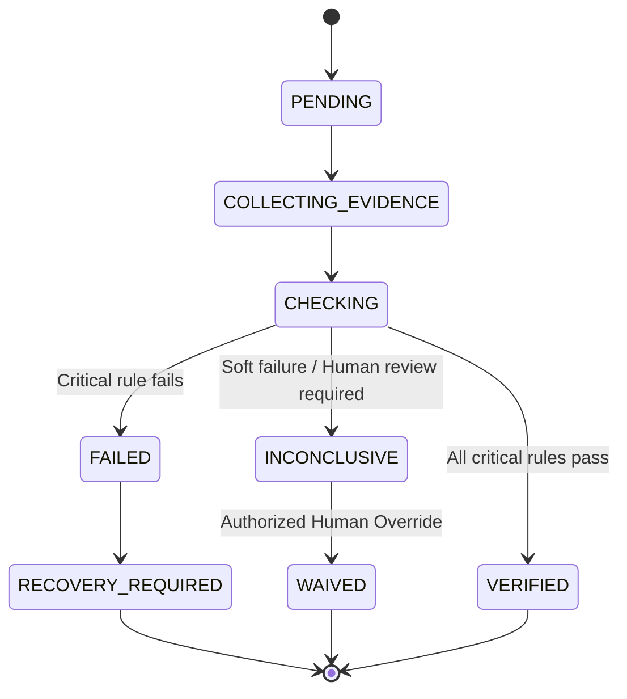

# Verification & Recovery Architecture (Phase 10)

## Overview

Phase 10 introduces the generic **Verification Engine** and **Recovery Engine** to the Autonomous AI Organization Platform. It enforces the foundational platform invariant:

$$\text{CLAIM} \neq \text{EVIDENCE} \neq \text{VERIFICATION} \neq \text{COMPLETION}$$

An agent claiming `"Task completed"` is never sufficient. The platform independently gathers evidence, evaluates machine-verifiable rules, applies policies, and executes deterministic recovery strategies when verification fails.

---

## Architectural Flow

---

## Evidence Trust Hierarchy

Evidence collected during task execution carries a structured trust level:

$$\text{UNTRUSTED} < \text{OBSERVED} < \text{EXECUTED} < \text{VALIDATED} < \text{AUTHORIZED} < \text{AUTHORITATIVE}$$

| Trust Level | Source Description | Example |
| :--- | :--- | :--- |
| `UNTRUSTED` | Agent text claims or unverified assertions | Agent prompt response `"I ran the tests"` |
| `OBSERVED` | Raw system logs or external observations | stdout log lines |
| `EXECUTED` | Recorded tool execution results | `ToolExecution` output, exit codes |
| `VALIDATED` | Deterministic system validation checks | File existence check, schema validation |
| `AUTHORIZED` | Authorized manager or decision approval | Code review approval, Decision authority |
| `AUTHORITATIVE` | Signed artifacts or independent verifier runs | Test suite run executed by `VerificationEngine` |

---

## Verification State Machine

---

## Failure Classification & Recovery Strategies

When verification or execution fails, `RecoveryEngine` classifies the failure into a `FailureCategory` and selects a deterministic `RecoveryStrategy`:

| Failure Category | Primary Recovery Strategy | Failure Budget Limits |
| :--- | :--- | :--- |
| `TEST_FAILURE` | `REWORK` | Max 3 reworks |
| `AGENT_FAILURE` | `REWORK` | Max 3 reworks |
| `TOOL_FAILURE` | `RETRY` | Max 3 retries |
| `TIMEOUT` | `RETRY` | Max 3 retries |
| `REQUIREMENT_FAILURE` | `REWORK` $\rightarrow$ `REASSIGN` | Max 2 reassignments |
| `AUTHORIZATION_FAILURE` | `ESCALATE` | Immediate escalation |
| `SECURITY_FAILURE` | `ESCALATE` | Immediate escalation |
| `POLICY_FAILURE` | `ESCALATE` | Immediate escalation |

---

## API Endpoints

- `POST /api/v1/verifications/outcomes`: Define expected outcomes and rules for a task.
- `POST /api/v1/verifications/evidence`: Register execution evidence with provenance.
- `POST /api/v1/verifications/verify`: Request independent verification for a task.
- `GET /api/v1/verifications/{id}`: Fetch verification result and check details.
- `POST /api/v1/verifications/{id}/override`: Perform audited human override or waiver.
