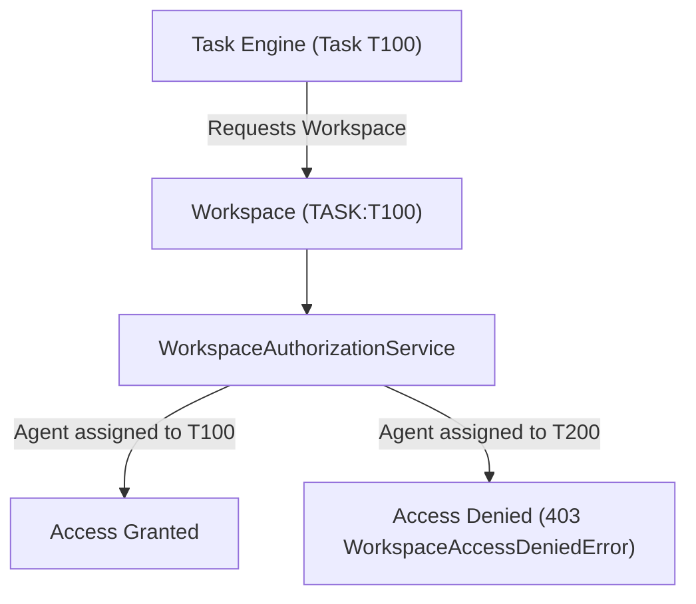

# Phase 7 — Workspace System Architecture

## Overview & Core Principles

The Phase 7 Workspace System provides controlled, sandboxed execution environments for Agents and Employees. It enforces strict boundary isolation so that tasks, projects, and employees operate in dedicated working environments without granting unrestricted host filesystem access.

$$\text{WORKSPACE} \neq \text{ARTIFACT} \neq \text{TASK}$$

### Key Invariants
1. **Explicit Ownership**: Every workspace has explicit ownership (`TASK`, `PROJECT`, `EMPLOYEE`, `AGENT`, `SHARED`). Anonymous or unowned workspaces are prohibited.
2. **State Machine Lifecycle**: Workspaces transition deterministically: `CREATED` $\rightarrow$ `ACTIVE` $\rightleftarrows$ `LOCKED` $\rightarrow$ `ARCHIVED` / `DESTROYED`.
3. **Task Workspace Isolation**: `WorkspaceAuthorizationService` verifies that an Agent assigned to Task $T1$ cannot access Workspace $W2$ owned by Task $T2$.
4. **Sandboxed File Operations**: All file manipulations within a workspace route through storage abstractions and sandboxing services rather than direct host path access.

---

## Workspace Domain Schema

```
Workspace
 ├── id: str
 ├── name: str
 ├── workspace_type: WorkspaceType (TASK, PROJECT, EMPLOYEE, AGENT, SHARED)
 ├── owner_id: str
 ├── status: WorkspaceStatus (CREATED, ACTIVE, LOCKED, ARCHIVED, DESTROYED)
 ├── task_id: str | None
 ├── project_id: str | None
 ├── employee_id: str | None
 ├── metadata: dict
 └── created_at / updated_at
```

---

## Workspace Lifecycle & Isolation Flow


