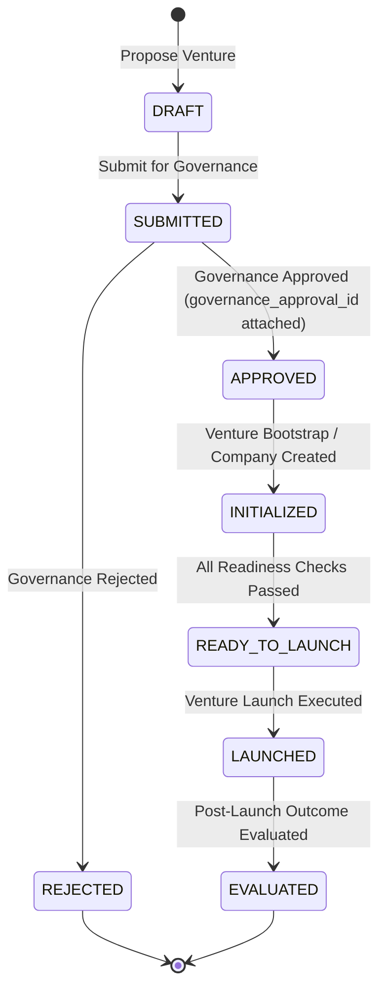
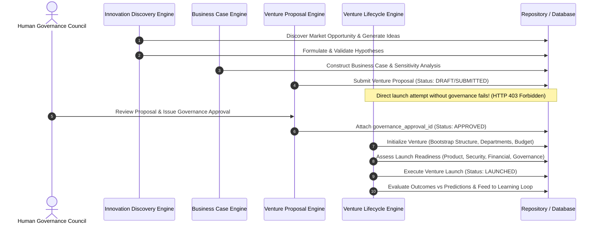

# Phase 28 — Autonomous Innovation, New Venture Creation & Governed Expansion

## Overview

Phase 28 introduces the Autonomous Innovation and New Venture Creation layer to the Autonomous AI Organization Platform.

The system is capable of systematically transforming unstructured research signals into validated business cases and governed new ventures while strictly preserving human governance authority and multi-tenant security boundaries.

---

## Strategic Invariants

```
THE SYSTEM MAY DISCOVER AND DESIGN NEW VENTURES, BUT IT MUST NOT GRANT ITSELF AUTHORITY TO CREATE OR CONTROL THEM WITHOUT GOVERNANCE.

IDEA != OPPORTUNITY != VALIDATED OPPORTUNITY != BUSINESS
BUSINESS HYPOTHESIS != BUSINESS FACT
RESEARCH != VALIDATION != EXPERIMENT != SIMULATION != REALITY
BUSINESS CASE != GUARANTEED OUTCOME
PROPOSAL != DECISION != AUTHORIZATION != EXECUTION
VENTURE PROPOSAL != COMPANY
AGENT RECOMMENDATION != AUTHORITY
```

---

## End-to-End Innovation Lifecycle Pipeline

```
OBSERVE RESEARCH & MARKET SIGNALS
            │
            ▼
   DISCOVER OPPORTUNITY  ───────►  VALIDATE OPPORTUNITY
            │
            ▼
      GENERATE IDEA
            │
            ▼
  FORMULATE HYPOTHESIS   ───────►  VALIDATE HYPOTHESIS / SIMULATE
            │
            ▼
 DESIGN PRODUCT & BUSINESS MODEL CONCEPT
            │
            ▼
  CONSTRUCT BUSINESS CASE & SENSITIVITY MODEL
            │
            ▼
  SUBMIT VENTURE PROPOSAL
            │
            ▼
   HUMAN GOVERNANCE REVIEW ───(REJECTED)───► ARCHIVE & LEARN
            │
        (APPROVED)
            │
            ▼
 INITIALIZE VENTURE / BOOTSTRAP NEW COMPANY
            │
            ▼
 ASSESS LAUNCH READINESS  ───────►  LAUNCH VENTURE
            │
            ▼
 EVALUATE VENTURE OUTCOMES & FEEDBACK TO PHASE 27 LEARNING
```

---

## Venture Lifecycle & State Machine



---

## Sequence Diagram: Autonomous Opportunity Discovery to Governed Launch



---

## Security & Multi-Tenant Isolation

1. **Governance Gate Enforcement**: Any attempt to initialize or launch a venture without a verified `governance_approval_id` raises `UnauthorizedVentureCreationError` and returns HTTP 403 Forbidden.
2. **Strict Multi-Tenant Isolation**: All operations filter strictly by `company_id`. Cross-tenant queries raise `CrossCompanyVentureAccessError`.
3. **Audit Trail**: Every state transition records timestamps, governor identity (`governor_id`), and associated risk metrics.

---

## API Summary

| Endpoint | Method | Description |
| :--- | :--- | :--- |
| `/api/v1/ventures/companies/{company_id}/opportunities` | POST | Discover new market opportunity |
| `/api/v1/ventures/companies/{company_id}/opportunities` | GET | List opportunities for company |
| `/api/v1/ventures/companies/{company_id}/opportunities/{id}/validate` | POST | Validate opportunity with evidence |
| `/api/v1/ventures/companies/{company_id}/ideas` | POST | Generate business idea |
| `/api/v1/ventures/companies/{company_id}/hypotheses` | POST | Formulate hypothesis for testing |
| `/api/v1/ventures/companies/{company_id}/business-cases` | POST | Construct quantitative business case |
| `/api/v1/ventures/companies/{company_id}/business-cases` | GET | List business cases |
| `/api/v1/ventures/companies/{company_id}/business-cases/{id}/sensitivity` | GET | Run sensitivity & Monte Carlo analysis |
| `/api/v1/ventures/companies/{company_id}/proposals` | POST | Submit formal venture proposal |
| `/api/v1/ventures/companies/{company_id}/proposals` | GET | List venture proposals |
| `/api/v1/ventures/companies/{company_id}/proposals/{id}/approve` | POST | Attach Human Governance approval |
| `/api/v1/ventures/companies/{company_id}/proposals/{id}/initialize` | POST | Initialize venture & bootstrap company |
| `/api/v1/ventures/companies/{company_id}/proposals/{id}/launch-readiness` | POST | Assess multi-domain launch readiness |
| `/api/v1/ventures/companies/{company_id}/proposals/{id}/launch` | POST | Execute venture launch |
| `/api/v1/ventures/companies/{company_id}/ventures/{id}/evaluate-outcome` | POST | Evaluate post-launch outcome |
| `/api/v1/ventures/companies/{company_id}/portfolio` | GET | Comprehensive venture portfolio summary |
