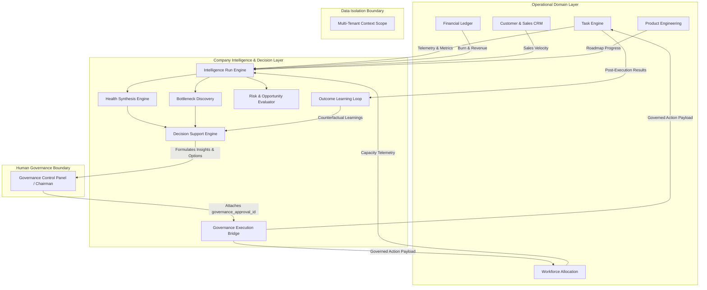
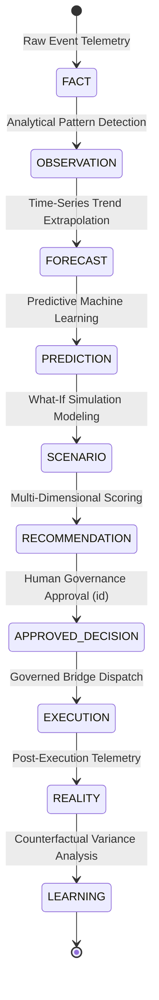
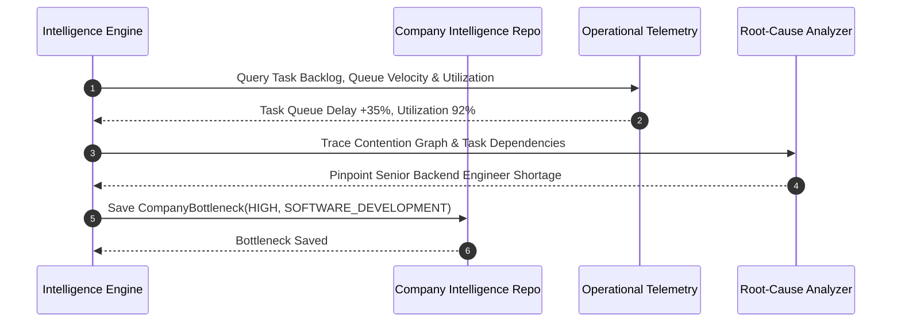
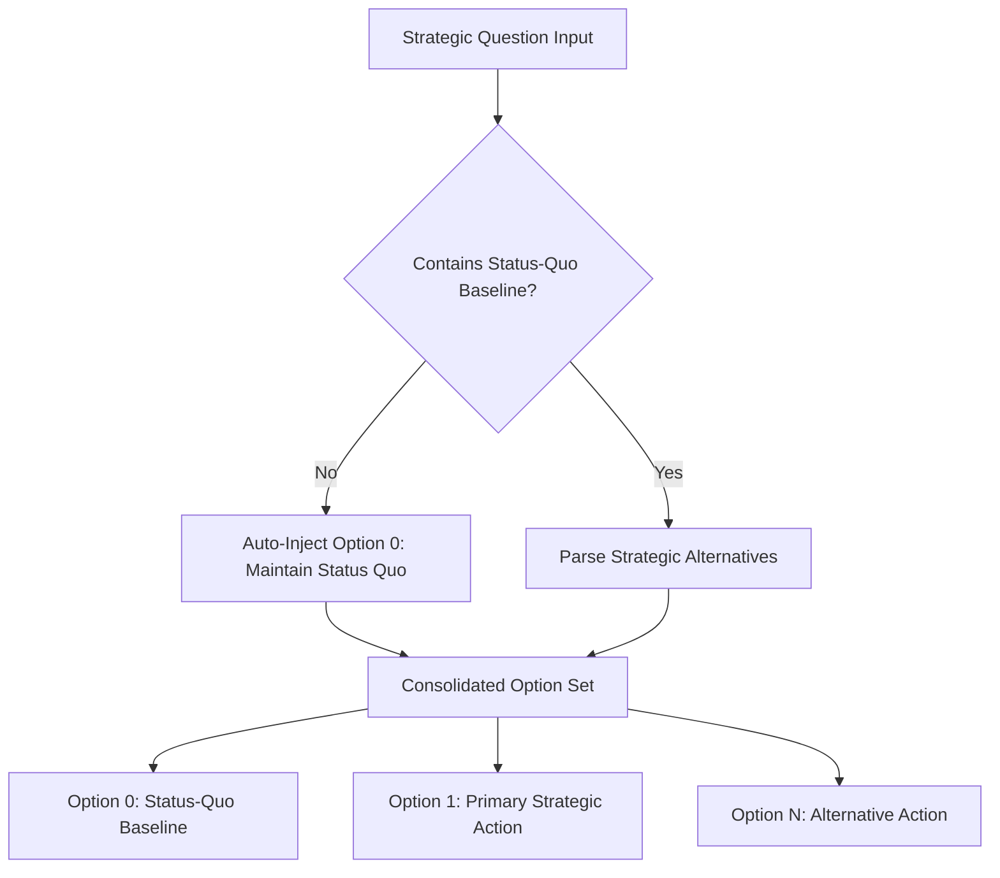
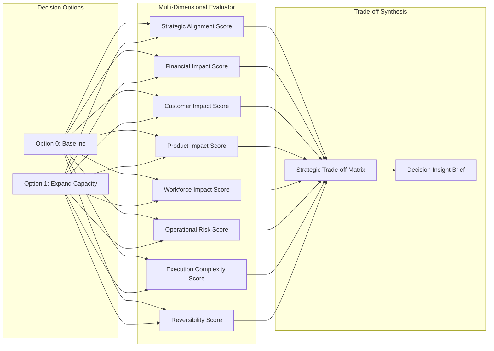
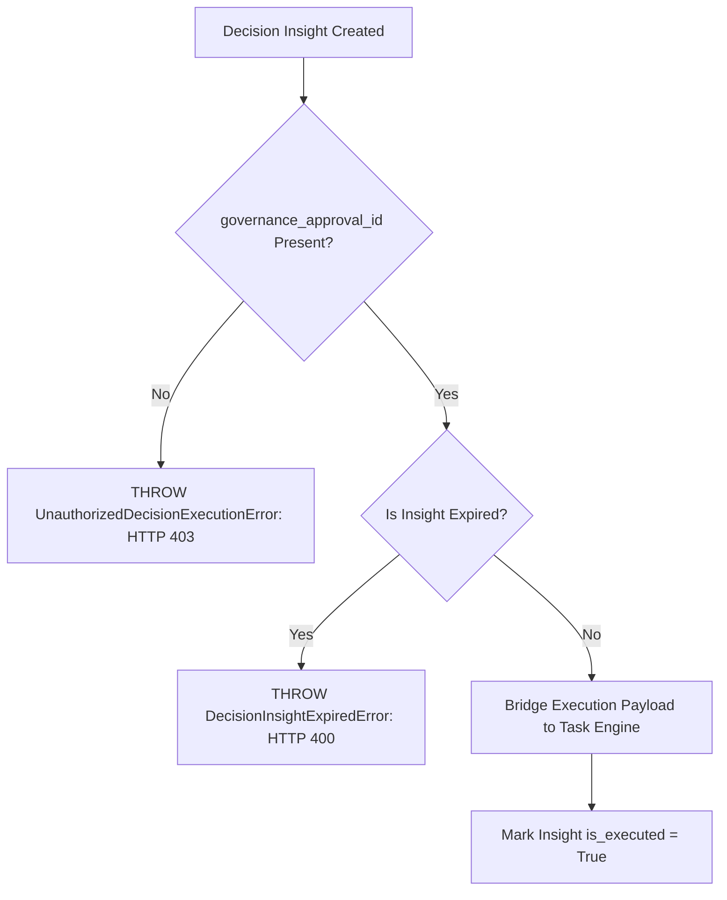
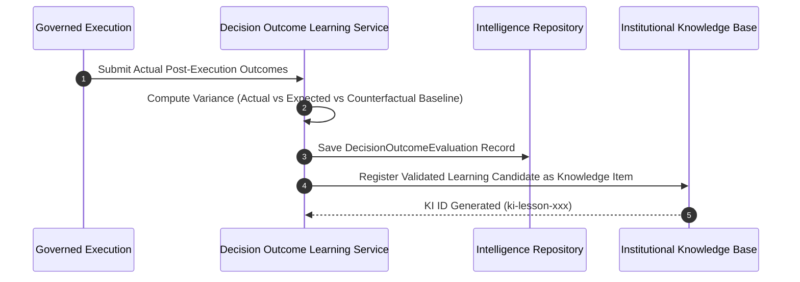
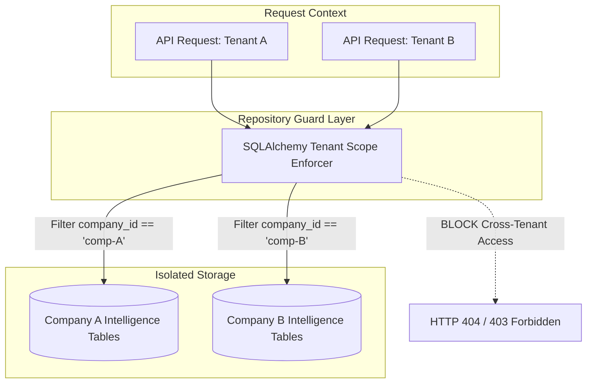
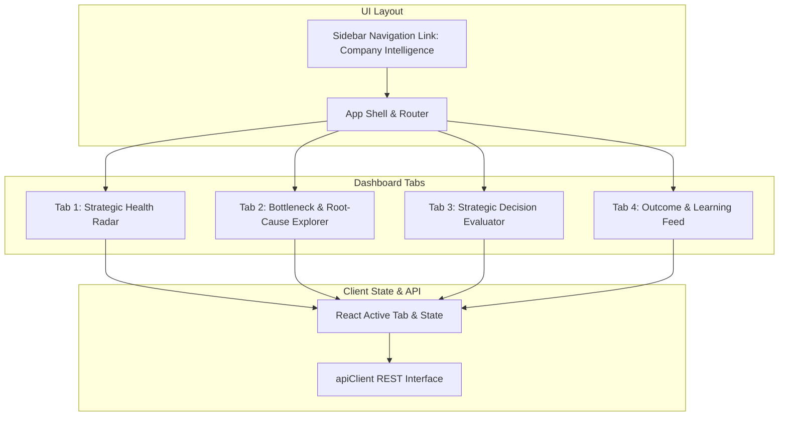

# Phase 26 — Advanced Company Intelligence, Decision Support & Strategic Optimization

## Architectural Vision & Core Invariants

Phase 26 introduces the **Company Intelligence & Decision Support System** for the Autonomous AI Organization Platform. It serves as the institutional brain that synthesizes operational telemetry into high-confidence insights, formulates multi-option strategic decision spaces, enforces human governance boundaries, and continuously learns from post-execution outcomes.

### Core Architectural Invariants
1. **Intelligence Invariant Pipeline**:
   $$\text{FACT} \neq \text{OBSERVATION} \neq \text{FORECAST} \neq \text{PREDICTION} \neq \text{SCENARIO} \neq \text{REALITY}$$
2. **Recommendation vs. Decision Separation**:
   $$\text{RECOMMENDATION} \neq \text{DECISION}$$
3. **Governed Decision Execution Flow**:
   $$\text{APPROVED DECISION} \neq \text{EXECUTION} \neq \text{VERIFICATION} \neq \text{OUTCOME} \neq \text{LEARNING}$$
4. **Operational Non-Mutation**: The Intelligence & Decision Support Layer is strictly advisory; it NEVER directly mutates operational state without going through governed execution bridges with valid `governance_approval_id` tokens.
5. **Status-Quo Baseline Requirement**: Every strategic evaluation MUST automatically inject and evaluate Option 0 (`NO_ACTION` maintain status quo) as a comparative baseline.

---

## System Architecture & Sequence Diagrams

### 1. Overall System Architecture Layering



---

### 2. Intelligence Invariant State Machine



---

### 3. Multi-Dimensional Company Health Synthesis Engine

```mermaid
flowchart LR
    subgraph Dimensions [10 Domain Dimensions]
        D1[Strategic]
        D2[Financial]
        D3[Product]
        D4[Customer]
        D5[GTM & Sales]
        D6[Workforce]
        D7[Engineering]
        D8[Operations]
        D9[Reliability]
        D10[Governance]
    end

    subgraph Engine [Health Assessment Synthesizer]
        SCORE[Weighted Score Aggregator]
        STATUS[Status Categorizer: HEALTHY | BALANCED | AT_RISK | CRITICAL]
        SYNTH[Risk & Opportunity Extractor]
    end

    D1 & D2 & D3 & D4 & D5 & D6 & D7 & D8 & D9 & D10 --> SCORE
    SCORE --> STATUS
    SCORE --> SYNTH
    STATUS --> AssessmentResult[CompanyHealthAssessment Artifact]
    SYNTH --> AssessmentResult
```

---

### 4. Operational Bottleneck & Root-Cause Discovery Flow



---

### 5. Multi-Option Decision Space Generator



---

### 6. Multi-Dimensional Option Evaluator & Strategic Trade-off Analyzer



---

### 7. Governance Boundary & Execution Bridge Checkpoint



---

### 8. Post-Execution Outcome Evaluation & Counterfactual Learning Loop



---

### 9. Multi-Tenant Intelligence Isolation Model



---

### 10. Pixel Office Company Intelligence Dashboard Architecture



---

## Summary of REST API Endpoints

| Method | Endpoint Path | Description |
|---|---|---|
| `POST` | `/api/v1/intelligence/companies/{company_id}/runs` | Start & execute an analytical intelligence run |
| `GET` | `/api/v1/intelligence/companies/{company_id}/runs/{run_id}` | Retrieve intelligence run findings & uncertainty score |
| `GET` | `/api/v1/intelligence/companies/{company_id}/runs` | List historical intelligence runs for company |
| `GET` | `/api/v1/intelligence/companies/{company_id}/health` | Fetch multi-dimensional health assessment |
| `GET` | `/api/v1/intelligence/companies/{company_id}/bottlenecks` | List detected operational bottlenecks & root-causes |
| `GET` | `/api/v1/intelligence/companies/{company_id}/risks` | Fetch categorized risk assessments |
| `POST` | `/api/v1/intelligence/companies/{company_id}/decision-questions` | Submit a first-class decision query |
| `POST` | `/api/v1/intelligence/companies/{company_id}/decision-questions/{question_id}/evaluate` | Formulate options (with baseline), evaluate & synthesize insight |
| `GET` | `/api/v1/intelligence/companies/{company_id}/decision-insights/{insight_id}` | Fetch decision insight brief |
| `POST` | `/api/v1/intelligence/companies/{company_id}/decision-insights/{insight_id}/execute` | Bridge decision to execution workflow (requires `governance_approval_id`) |
| `POST` | `/api/v1/intelligence/companies/{company_id}/decision-outcomes/evaluate` | Post-execution outcome variance tracking & counterfactual learning |
