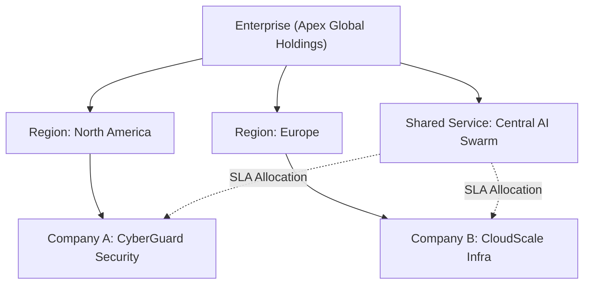
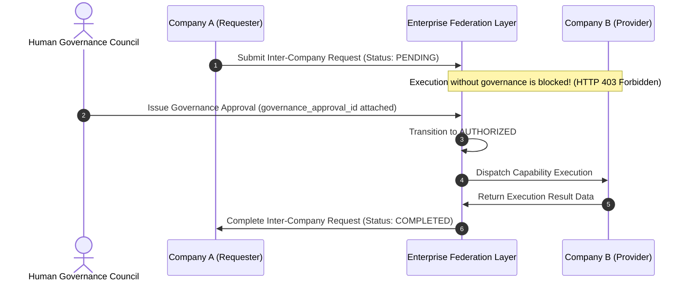

# Phase 29 — Enterprise-Scale Autonomous Company Platform, Federation & Large-Scale Operations

## Overview

Phase 29 builds the Enterprise OS orchestration and federation layer above the multi-company platform (Phases 1–28).

The Enterprise OS coordinates multi-company topologies, company federation, subsidiaries, business units, regional operations, shared services, enterprise portfolios, strategy cascading, delegated governance & policy inheritance, authority delegation, resource federation, capacity planning, intercompany request routing, dependency graphs, enterprise health, risk/opportunity management, knowledge/learning federation, and enterprise-wide observability without mutating or replacing existing Company OS, Agent Runtime, Governance, Task Engine, or Swarm capabilities.

---

## Strategic Invariants

```
ENTERPRISE OS IS AN ORCHESTRATION & FEDERATION LAYER ABOVE COMPANY OS.
ENTERPRISE != COMPANY
COMPANY DATA != ENTERPRISE DATA AUTOMATICALLY
COMPANY LEARNING != ENTERPRISE LEARNING
STRATEGIC INITIATIVE != COMPANY INSTRUCTION AUTOMATICALLY
POLICY INHERITANCE MUST NOT SILENTLY WEAKEN MANDATORY SAFETY CONSTRAINTS
AUTHORITY IS EXPLICIT: NO IMPLICIT AUTHORITY INHERITANCE ACROSS COMPANIES
RECOMMENDATION != AUTHORIZATION != EXECUTION
SWARM != ENTERPRISE TOPOLOGY
LLM AGENT RECOMMENDATION != ENTERPRISE AUTHORITY
```

---

## Enterprise Organizational Topology Graph



---

## Sequence Diagram: Governed Inter-Company Request Lifecycle



---

## Policy Inheritance Resolution (`resolve_effective_policy`)

```mermaid
flowchart TD
    ROOT["Root Enterprise Policy Profile (Max Spend: $50,000)"]
    CHILD["Child Node Policy Request (Max Spend: $100,000)"]
    ENGINE["Deterministic Policy Resolver"]
    RESULT["Effective Policy Output (Max Spend: $50,000)"]

    ROOT --> ENGINE
    CHILD --> ENGINE
    ENGINE -->|MIN(Root, Child)| RESULT
```

---

## REST API Summary

| Endpoint | Method | Description |
| :--- | :--- | :--- |
| `/api/v1/enterprises` | POST | Create Root Enterprise |
| `/api/v1/enterprises` | GET | List all Enterprises |
| `/api/v1/enterprises/{id}` | GET | Get Enterprise details |
| `/api/v1/enterprises/{id}/topology/nodes` | POST | Create organizational topology node |
| `/api/v1/enterprises/{id}/topology` | GET | Retrieve full organizational hierarchy tree |
| `/api/v1/enterprises/{id}/companies/attach` | POST | Attach autonomous company to enterprise |
| `/api/v1/enterprises/{id}/services` | POST | Register shared service |
| `/api/v1/enterprises/{id}/services` | GET | List enterprise shared services |
| `/api/v1/enterprises/{id}/objectives` | POST | Create strategic objective |
| `/api/v1/enterprises/{id}/objectives/{parent_id}/cascade` | POST | Cascade objective to child node |
| `/api/v1/enterprises/{id}/policy/profiles` | POST | Set policy profile |
| `/api/v1/enterprises/{id}/nodes/{node_id}/effective-policy` | GET | Resolve effective policy for node |
| `/api/v1/enterprises/{id}/authority/grants` | POST | Grant explicit delegated authority |
| `/api/v1/enterprises/{id}/capacity` | GET | Retrieve capacity snapshot |
| `/api/v1/enterprises/{id}/intercompany-requests` | POST | Submit inter-company request |
| `/api/v1/enterprises/{id}/intercompany-requests/{req_id}/authorize` | POST | Attach Human Governance authorization |
| `/api/v1/enterprises/{id}/health` | GET | Aggregate multi-dimensional health scorecard |
| `/api/v1/enterprises/{id}/context` | GET | Retrieve framed enterprise advisory context |
