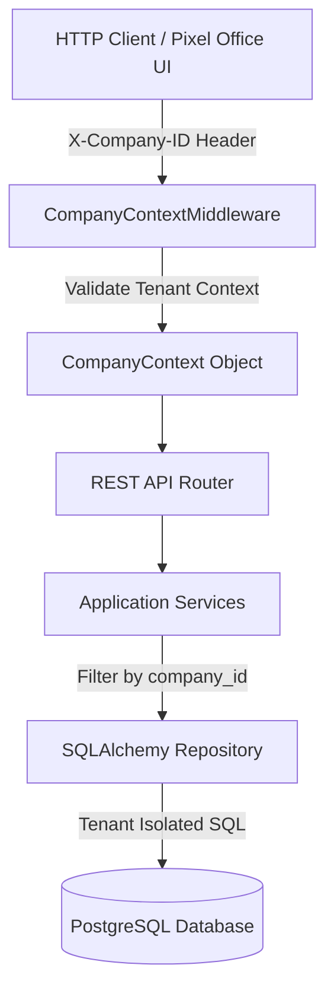
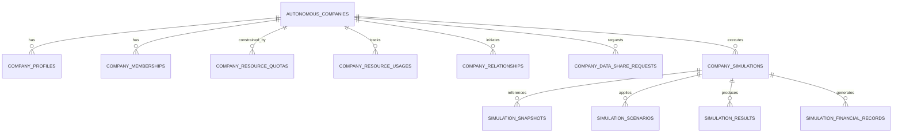
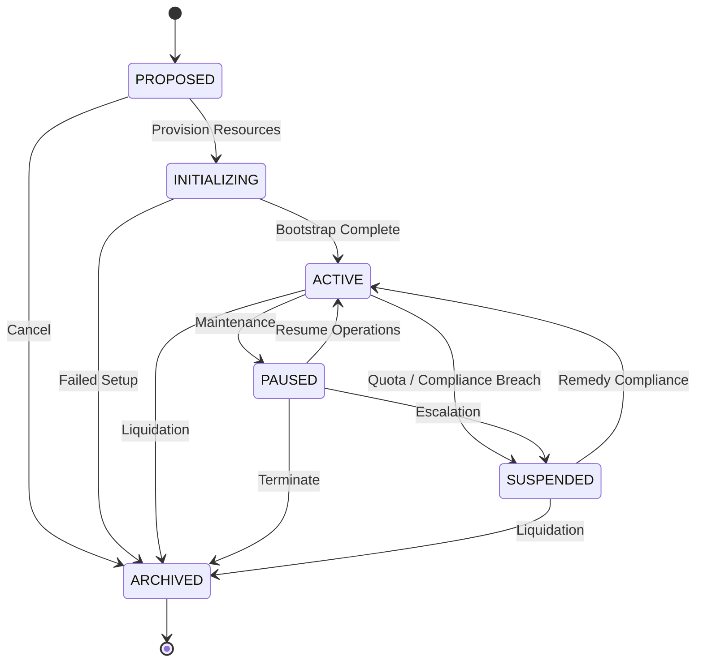
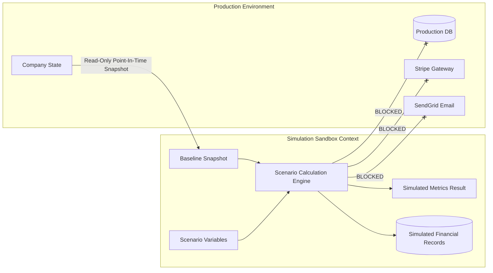
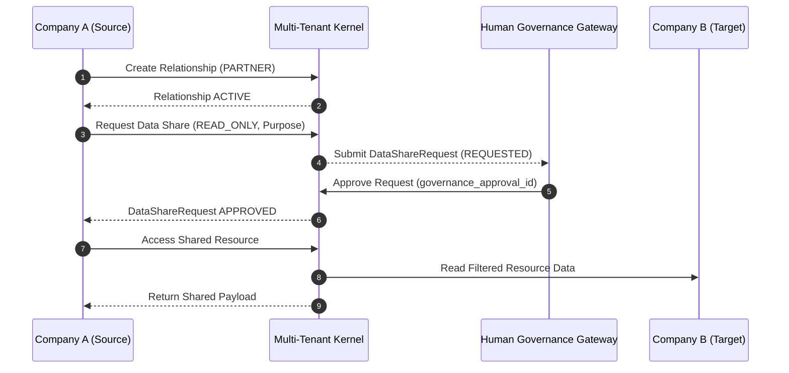
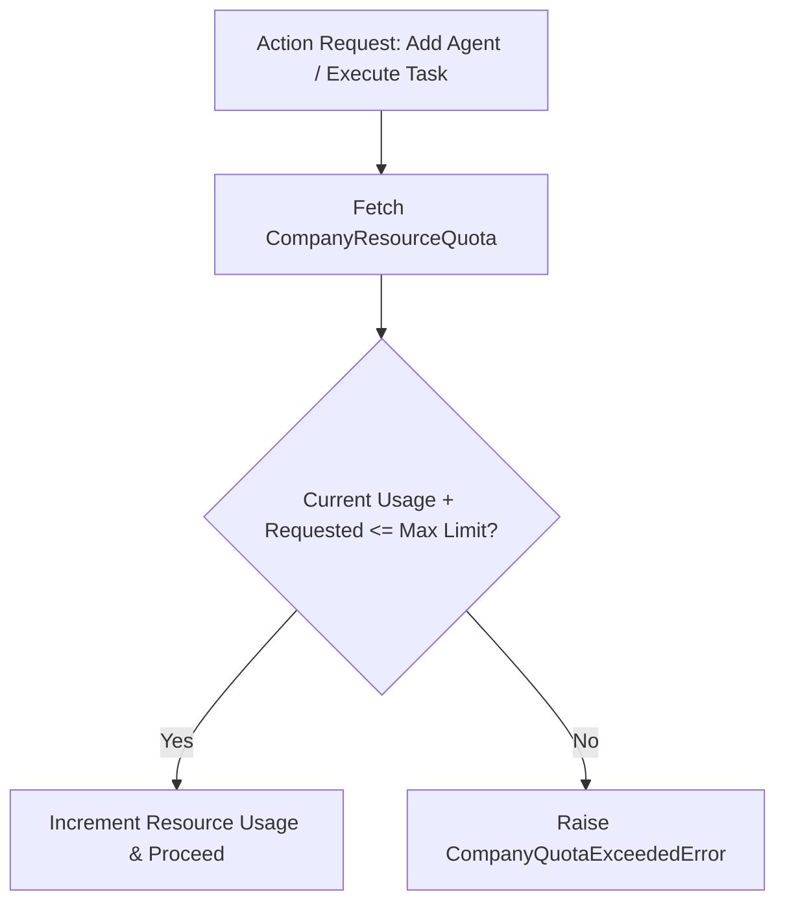
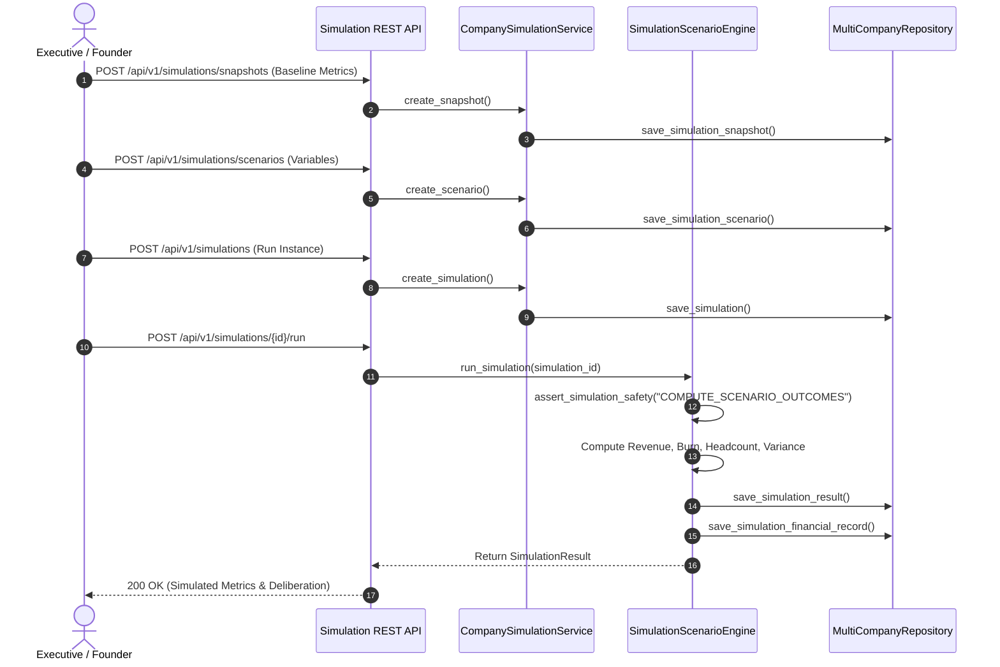
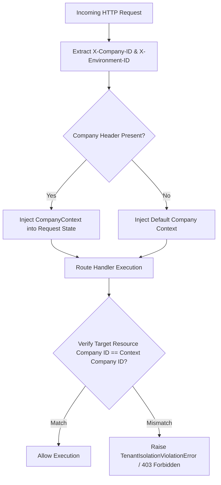
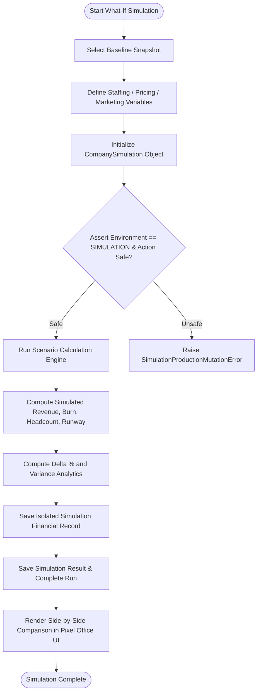

# Phase 25 — Multi-Company, Multi-Tenant Organization & Company Simulation Architecture

## 1. Executive Overview

Phase 25 transforms the Autonomous AI Organization Platform into a multi-company, multi-tenant enterprise framework capable of hosting and operating multiple isolated autonomous AI companies on shared production infrastructure. In addition to multi-tenant isolation, Phase 25 introduces a **What-If Company Simulation Engine** allowing executives, founders, and AI managers to simulate structural company changes, headcount growth, pricing adjustments, and market shocks in a sandbox environment with absolute isolation from production state.

### Key Architectural Invariants
```
TENANT != USER
COMPANY != EMPLOYEE
COMPANY != AGENT
REALITY != SIMULATION
SIMULATION != AUTHORITATIVE COMPANY STATE
COMPANY A != COMPANY B
```

1. **Strict Data & Resource Isolation**: Cross-company access is denied by default. Data access between distinct companies requires explicit relationship definition, data share requests, and human governance approval.
2. **Deterministic Safety Isolation**: Simulation execution strictly blocks real payment gateway calls, external email delivery, production database mutation, or contract signing.
3. **Resource Quotas & Capacity Control**: Each company is constrained by configurable resource quotas (Agents, Employees, Monthly Budget, Storage, API limits).

---

## 2. Multi-Tenant Architecture & Boundary Middleware

Every incoming request passes through the `CompanyContextMiddleware`, which resolves tenant context (`X-Company-ID`, `X-User-ID`, `X-Environment-ID`, `X-Simulation-ID`) and injects a `CompanyContext` into the request state.



---

## 3. Database Schema & ERD

Phase 25 adds 10 dedicated multi-tenant and simulation tables to PostgreSQL via Alembic Migration `024_create_phase25_multi_company_tables.py`.



---

## 4. Company Lifecycle State Machine

Autonomous companies transition through strict lifecycle states enforced by `Company.transition_lifecycle()`.



---

## 5. What-If Simulation Sandbox Engine & Safety Boundaries

The Scenario Engine computes deterministic outcome projections based on baseline snapshots and scenario variables.



---

## 6. Governed Cross-Company Data Sharing

Cross-company communication and data sharing require explicit relationship establishment, data share request submission, and human governance approval.



---

## 7. Quota Enforcement Flowchart



---

## 8. Simulation Engine Execution Sequence



---

## 9. Security Verification & Middleware Flowchart



---

## 10. End-to-End Simulation Pipeline Flowchart



---

## 11. REST API Endpoints Reference

### Multi-Company Endpoints (`/api/v1/companies`)
- `GET /api/v1/companies` — List all managed companies.
- `POST /api/v1/companies` — Provision new autonomous company.
- `GET /api/v1/companies/{id}` — Get company details.
- `POST /api/v1/companies/{id}/lifecycle` — Transition company lifecycle state.
- `GET /api/v1/companies/{id}/quota` — Get company resource quota utilization.
- `POST /api/v1/companies/relationships` — Create company relationship.
- `POST /api/v1/companies/data-shares` — Request cross-company data sharing.
- `POST /api/v1/companies/data-shares/{id}/approve` — Approve data share request.

### Simulation Endpoints (`/api/v1/simulations`)
- `POST /api/v1/simulations/snapshots` — Create baseline point-in-time snapshot.
- `POST /api/v1/simulations/scenarios` — Build what-if simulation scenario.
- `POST /api/v1/simulations` — Create simulation run instance.
- `POST /api/v1/simulations/{id}/run` — Execute scenario calculation engine.
- `GET /api/v1/simulations/{id}/result` — Get simulation outcome comparison.

---

## 12. Verification & Safety Verification

All 19 Phase 25 tests pass clean:
- `test_company_domain.py` (4 passed)
- `test_company_repository.py` (3 passed)
- `test_company_services.py` (3 passed)
- `test_simulation_services.py` (2 passed)
- `test_company_routes.py` (3 passed)
- `test_multi_company_security_isolation.py` (2 passed)
- `test_simulation_safety_isolation.py` (2 passed)
