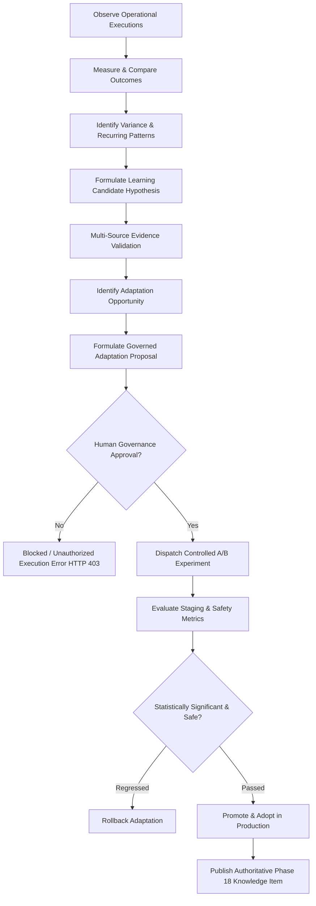
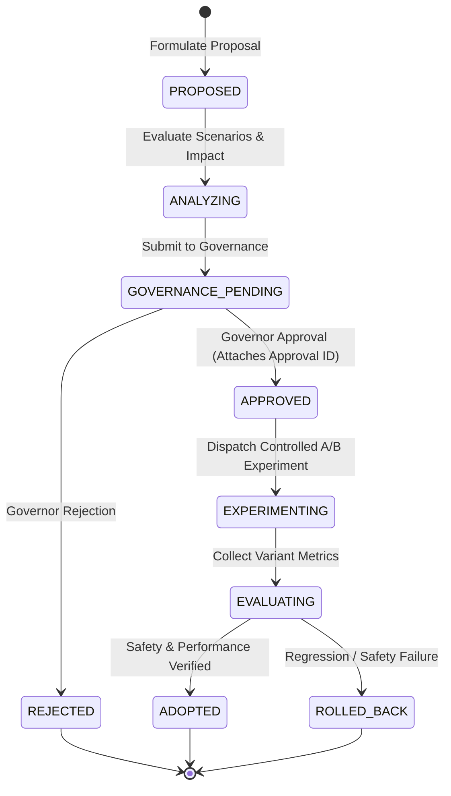

# Continuous Organizational Learning, Governed Adaptation & Self-Improvement Architecture

## Phase 27 Architectural Specification

### 1. Architectural Overview & System Objective

Phase 27 introduces the Continuous Organizational Learning, Adaptation & Governed Self-Improvement layer for the Autonomous AI Organization Platform.

This layer closes the operational feedback loop across all platform subsystems (Software Development, Business Operations, Product/GTM, Failure Recovery, Governance, Workforce Allocation) by enabling the organization to continuously observe execution outcomes, compare actual vs expected performance, identify recurring patterns, synthesize candidate lessons, validate hypotheses, propose governed adaptations, test changes via controlled A/B experiments, and promote validated operational improvements into permanent institutional knowledge.

---

### 2. Core Invariants & Safety Guardrails

The platform strictly enforces seven fundamental invariants to guarantee safety, operational stability, and human oversight:

1. **`OBSERVATION != LESSON != KNOWLEDGE != RULE`**: An observation is raw operational telemetry. A lesson is a candidate hypothesis. Institutional knowledge requires multi-source validation. An operational rule requires human governance approval.
2. **`PATTERN != CAUSALITY != TRUTH`**: Statistical correlation does not establish causation without empirical verification.
3. **`LEARNING CANDIDATE != VALIDATED LEARNING != AUTHORITATIVE POLICY`**: Unvalidated candidates cannot guide production agent execution.
4. **`RECOMMENDATION != ADAPTATION`**: Suggestions generated by AI models do not alter operational workflows directly.
5. **`ADAPTATION PROPOSAL != APPROVED CHANGE != EXECUTION != SUCCESS`**: Every proposed change must progress through explicit, governed state transitions.
6. **`LEARNING != SELF-MODIFICATION`**: Platform code, model weights, and core architectural rules cannot be modified autonomously by LLM inference.
7. **`LEARNING != AUTHORITY`**: Learned lessons are advisory and NEVER override system safety policies, governance rules, or permission boundaries.

Direct execution of an adaptation proposal without a valid `governance_approval_id` raises `UnauthorizedAdaptationExecutionError` (HTTP 403 Forbidden).

---

### 3. Adaptation Proposal Lifecycle & State Machine

---

### 4. REST API Endpoint Reference

| Endpoint | Method | Description |
|---|---|---|
| `/api/v1/learning/companies/{company_id}/cycles` | `POST` | Start a new continuous learning cycle run |
| `/api/v1/learning/companies/{company_id}/cycles/{cycle_id}` | `GET` | Get details of a learning cycle run |
| `/api/v1/learning/companies/{company_id}/cycles` | `GET` | List all learning cycles for a company |
| `/api/v1/learning/companies/{company_id}/observations` | `POST` | Ingest raw operational telemetry observation |
| `/api/v1/learning/companies/{company_id}/comparisons` | `POST` | Record expected vs actual outcome comparison |
| `/api/v1/learning/companies/{company_id}/candidates` | `POST` | Formulate a learning candidate hypothesis |
| `/api/v1/learning/companies/{company_id}/candidates/{id}/validate` | `POST` | Validate candidate and upgrade confidence |
| `/api/v1/learning/companies/{company_id}/lessons` | `GET` | List validated learning lessons |
| `/api/v1/learning/companies/{company_id}/patterns` | `GET` | List detected operational patterns |
| `/api/v1/learning/companies/{company_id}/improvements` | `POST` | Identify organizational improvement opportunity |
| `/api/v1/learning/companies/{company_id}/adaptations` | `POST` | Formulate governed adaptation proposal |
| `/api/v1/learning/companies/{company_id}/adaptations/{id}/approve` | `POST` | Attach human governance approval ID |
| `/api/v1/learning/companies/{company_id}/adaptations/{id}/experiment` | `POST` | Dispatch controlled A/B experiment (Requires approval ID) |
| `/api/v1/learning/companies/{company_id}/adaptations/{id}/evaluate-outcome` | `POST` | Evaluate experiment metrics & detect regressions |
| `/api/v1/learning/companies/{company_id}/adaptations/{id}/adopt` | `POST` | Promote adaptation into production policy |
| `/api/v1/learning/companies/{company_id}/adaptations/{id}/rollback` | `POST` | Rollback adaptation to pre-experiment state |
| `/api/v1/learning/companies/{company_id}/context` | `GET` | Retrieve framed advisory learning context string |

---

### 5. Multi-Tenant Security & Governance Enforcement

All Phase 27 data tables (`learning_cycles`, `learning_observations`, `outcome_comparisons`, `learning_candidates`, `learning_validations`, `learning_patterns`, `improvement_opportunities`, `adaptation_proposals`, `adaptation_executions`, `adaptation_outcomes`) include an indexed `company_id` column.

- Queries across company boundaries return 0 records or HTTP 404.
- Cross-company access attempts raise `CrossCompanyAccessDeniedError`.
- Direct execution without human governance authorization raises `UnauthorizedAdaptationExecutionError` (HTTP 403).
