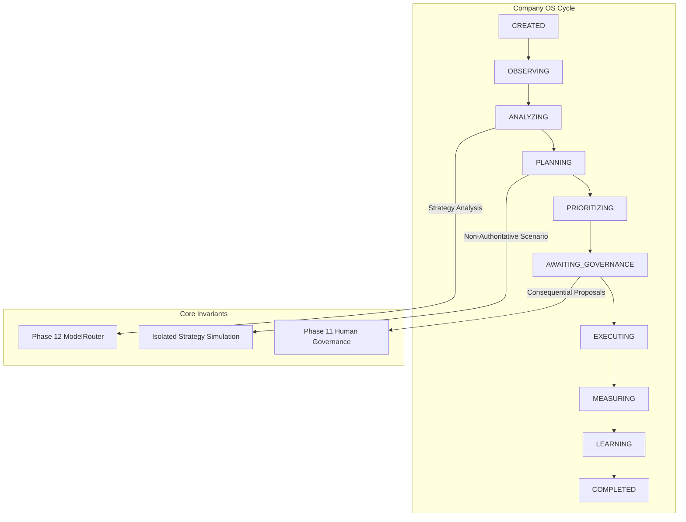

# Phase 16 — Autonomous Company Operations, Strategic Intelligence & Governed Organizational Evolution

## Architecture Overview

Phase 16 introduces the visual and operating company-level OS layer (`Company Strategy -> Observe -> Analyze -> Plan -> Prioritize -> Govern -> Allocate -> Execute -> Verify -> Measure -> Learn -> Replan`) that turns the autonomous organization into a controlled, governed autonomous company.

## Key Components

1. **Domain Layer** (`src/domain/company.py`, `src/domain/strategy.py`):
   - `AutonomousCompany`, `CompanyOperatingCycle` (10-state lifecycle), `CompanyKPISnapshot`, `CompanyHealthSnapshot`, `CompanyRisk`, `CompanyOpportunity`, `PortfolioItem`, `ResourceAllocationPlan`, `ContinuousImprovementProposal`.
   - `CompanyStrategy` versioning, `StrategicObjective`, `StrategicInitiative`, `StrategicAnalysis`, `StrategyProposal`, `StrategySimulation`.

2. **Infrastructure Layer** (`src/infrastructure/models/company_model.py`, `src/infrastructure/repositories/company_repository.py`, Migration `018`):
   - SQLAlchemy ORM models, migration 018, and `SQLAlchemyCompanyRepository`.

3. **Application Layer**:
   - `CompanyObservationService` (`src/application/company_observation_service.py`): Aggregates facts, metrics, and calculates 9-dimensional company health.
   - `StrategicIntelligenceService` (`src/application/strategic_intelligence_service.py`): Formulates strategies, proposals, and executes non-authoritative simulations (`is_authoritative = False`).
   - `CompanyOperatingCycleService` (`src/application/company_operating_cycle_service.py`): Orchestrates 10-state operating cycle loop, checkpointing, pause/resume, and governance authorization.
   - `ExecutiveOrchestrationService` (`src/application/executive_orchestration_service.py`): Generates executive strategic reports, manages portfolio, resource plans, and retrospectives.

4. **API Layer** (`src/api/schemas/company.py`, `src/api/routes/company.py`):
   - Full REST API endpoints under `/api/v1/company`.

5. **Pixel Office Projection** (`src/application/office_projection_service.py`):
   - Projects operating cycle state, health status, and active strategy title into real-time office projections.

## Core Architectural Invariants

- `EMPLOYEE != AGENT != LLM != TEAM != DEPARTMENT != MODEL != COMPANY OS`
- **Simulations Are Non-Authoritative**: `StrategySimulation.is_authoritative` is enforced `False` to guarantee simulations never mutate production company state.
- **Consequential Changes Require Governance**: Structural, workforce, or policy proposals require Phase 11 Human Governance authorization (`AWAITING_GOVERNANCE`).
