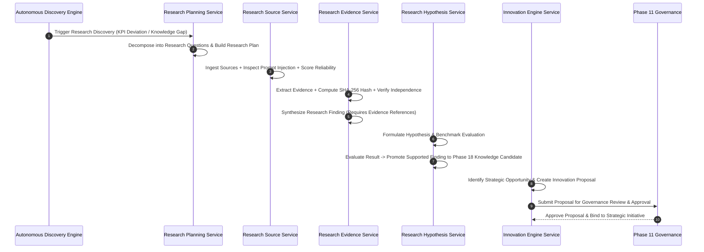

# Phase 19 — Autonomous Research, Discovery & Innovation Engine

## Executive Overview
Phase 19 extends the Autonomous AI Organization Platform above the Company Operating System (Phase 16), Institutional Knowledge (Phase 18), and Governance (Phase 11) layers. It introduces an autonomous Research & Innovation engine capable of:
1. Detecting knowledge gaps and performance anomalies via the **Autonomous Discovery Engine**.
2. Decomposing research requests into sub-questions and constructing structured **Research Plans**.
3. Registering internal & external sources with automated **Prompt Injection Security Inspection** and explainable **Reliability Scoring**.
4. Enforcing **Source Independence** via content snippet SHA-256 integrity hashing to detect derivative duplicates.
5. Formulating empirical **Hypotheses**, running benchmarks & technology evaluations, and automatically promoting supported conclusions to **Phase 18 Knowledge Candidates**.
6. Synthesizing research findings into high-value **Research Opportunities**, generating **Innovation Proposals**, and submitting them for **Phase 11 Governance Approval** prior to binding with Strategic Initiatives.

---

## Core Invariants Enforced
- `RESEARCH != KNOWLEDGE` — Research activities and evidence collection are distinct from validated organizational truth.
- `SOURCE != EVIDENCE` — Raw source material is not evidence until extracted, verified for integrity, and analyzed.
- `EVIDENCE != TRUTH AUTOMATICALLY` — Uncorroborated evidence does not constitute organizational fact.
- `HYPOTHESIS != FACT` — Hypotheses remain unverified propositions until empirically evaluated.
- `RESULT != CONCLUSION AUTOMATICALLY` — Raw experimental metrics require structured analysis before formulating conclusions.
- `CONCLUSION != KNOWLEDGE AUTOMATICALLY` — Conclusions must undergo Phase 18 validation before becoming authoritative knowledge.
- `RECOMMENDATION != DECISION` — Strategic technology recommendations require explicit human/governance approval.
- `INNOVATION PROPOSAL != INITIATIVE` — Innovation proposals must be approved by Phase 11 Governance before becoming strategic initiatives.
- `EXPERIMENT != PRODUCTION` — Research sandboxes and benchmarks are strictly isolated from production environments.
- `EXTERNAL CONTENT != TRUSTED INSTRUCTION` — All untrusted external text is scanned for prompt injection attacks and assigned a zero reliability score if malicious.
- `LLM OUTPUT != ORGANIZATIONAL TRUTH` — Model outputs are subject to verification and empirical benchmarking.

---

## Domain Architecture & Workflow

---

## REST API Reference

### Research Endpoints
- `POST /api/v1/research/requests` — Create a new research request.
- `GET /api/v1/research/requests` — List all active/historical research requests.
- `POST /api/v1/research/requests/{id}/decompose` — Decompose request into sub-questions.
- `POST /api/v1/research/plans` — Create a structured research plan with required capabilities.
- `POST /api/v1/research/sources` — Register internal/external source with prompt injection scan.
- `POST /api/v1/research/evidence` — Ingest evidence snippet, compute hash, and check source independence.
- `POST /api/v1/research/findings` — Synthesize evidence-backed research finding.
- `POST /api/v1/research/hypotheses` — Formulate hypothesis.
- `POST /api/v1/research/hypotheses/{id}/evaluate` — Evaluate hypothesis result and trigger automated Phase 18 Knowledge promotion.

### Innovation Endpoints
- `POST /api/v1/innovation/opportunities` — Identify strategic research opportunity.
- `POST /api/v1/innovation/proposals` — Create innovation proposal.
- `GET /api/v1/innovation/proposals` — List innovation proposals.
- `POST /api/v1/innovation/proposals/{id}/approve` — Approve innovation proposal via Phase 11 Governance.

---

## Verification & Testing
- Unit tests: `tests/unit/test_research_domain.py`, `tests/unit/test_research_services.py`
- Integration tests: `tests/integration/test_research_repository.py`, `tests/integration/test_research_api.py`
- Security tests: `tests/security/test_research_security.py`
- Failure injection tests: `tests/failure_injection/test_research_failure_injection.py`
- Concurrency tests: `tests/concurrency/test_research_concurrency.py`
- E2E demonstration script: `scripts/demo_autonomous_research_innovation_flow.py`
